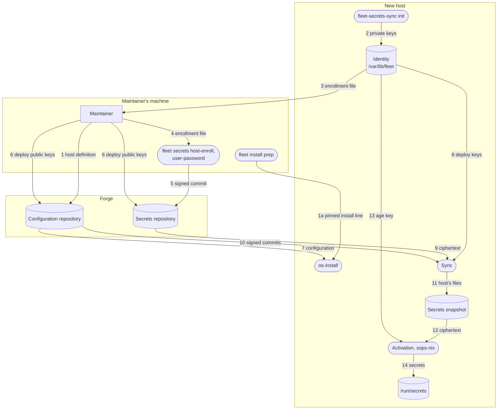

# NixOS / nix-darwin Configuration Flake

A multi-platform configuration flake for NixOS, macOS and Home Manager
environments. Machines are declared under `hosts/`, per-user configuration under
`users/`, and behaviour is driven by the `conf.*` option tree. A machine's
[role](#roles) sets defaults that any host can override. The `conf.*` option tree is a
generalised group of simple toggles for most common config recipes that can be applied
on hosts without hardcoding. It is also toggleable which helps move more of the logic to
a common configuration module rather than being per host.

## Repository Layout

```
├── flake.nix                        # entry point; discovers hosts/
├── bootstrap                        # first-run script; see First run
├── fleet/
│   └── allowed_signers              # keys the fleet accepts on commits; see Signing commits for a fleet
├── lib/
│   ├── apps/                        # os-install, system-switch, home-switch, check-purity, fleet-secrets, fleet; rpi-image and secrets-harness on Linux; darwin-rebuild on macOS
│   ├── mkFleet.nix                  # lib.mkFleet: a fleet's systems, homes and apps from its host folders; see A private fleet
│   ├── mkHost.nix                   # host factory (NixOS / nix-darwin)
│   ├── secrets-sync.nix             # fleet-secrets-sync and fleet-identity, used by the sync and os-install
│   ├── clone-flake.nix              # fleet-clone-flake: clones a private flake for an install, at an exact commit
│   ├── forge-host-keys.nix          # GitHub's SSH host keys, which every fetch over SSH is checked against
│   ├── buildUser.nix                # assembles a user's Home Manager modules
│   ├── mkUser.nix                   # standalone Home Manager builder
│   └── flakeLib.nix                 # helpers shared by this flake's modules
├── hosts/<hostname>/                # one directory per machine, auto-discovered
│   ├── default.nix                  # nixpkgs.hostPlatform and conf.* settings
│   ├── hardware-configuration.nix   # Linux only, from nixos-generate-config
│   └── *.nix                        # every file here is imported as a module
├── users/<username>/                # optional per-user configuration
│   └── default.nix                  # merged into that user's home, both paths
├── tests/                           # VM and evaluation checks wired into the flake's `checks`
│   │                                # one folder per area: boot, fleet, lib (shared helpers), networking, pi-gw, rpi-image, secrets, users
│   └── secrets/                     # also holds secrets-harness, the local stand-in for the secrets repository
├── tools/fleet/                     # fleet, the guided command-line tool; runbooks/ has a page per command
└── modules/
    ├── conf/                        # the conf.* vocabulary: options/<concern>.nix, role.nix, machineType.nix
    ├── common/                      # configuration valid on both platforms
    ├── linux/                       # NixOS implementation, one folder per concern
    ├── darwin/                      # nix-darwin implementation
    └── user/                        # Home Manager baseline for managed users
```

Most concerns have one option file in `modules/conf/options/` and one folder
or file of the same name under `modules/linux/`, so the word in `conf.<name>`
usually finds both the declaration and the implementation. The exceptions are
`conf.hardware`, implemented in `baseline/`, `graphics/` and `power/`, and
`conf.users`, implemented in `host/` and `secrets/`. A folder's `default.nix` only
imports its parts; each part sets its own options under its own `mkIf`.

## Usage

### First run

On a machine this flake does not configure yet, one command does everything:

```bash
curl -sSfL https://raw.githubusercontent.com/nnishant776/fleet-manager/main/bootstrap | sh -s -- <hostname>
```

`bootstrap` installs Nix where it is missing — the one step Nix cannot do for
itself — and then hands over to the flake's own tools:

| Running on | It does |
|---|---|
| macOS | installs Lix if needed, then switches to `<hostname>` with the nix-darwin this flake pins |
| NixOS installer ISO | runs `fleet install`, a guided `os-install`: built from `REV` when given, otherwise downloaded from the latest release and checked against its `SHA256SUMS`; if neither works, `os-install` by itself. `<hostname>` is optional, and further arguments are passed on |
| an installed NixOS host | runs `system-switch` for `<hostname>` (default: this machine's hostname), building from the same flake |
| another Linux | installs Lix and stops; only Home Manager is supported there |

`FLAKE=github:org/repo/<tag>` in front of `sh` makes it use another flake, or a
pinned tag so that machines do not follow every commit on `main`. MDM can run
the same command on a new Mac.

**Installing from checked commits.** The command above takes whatever `main`
has at that moment, which anyone who can push could have changed. To install
only commits whose signatures you have checked, run this on your own machine,
in a checkout of the configuration:

```bash
fleet install prep <hostname>
```

It checks that the checkout's newest commit is signed by a key you trust and
pushed, and so is the fleet-manager commit the installer comes from. The keys
you trust are your own copy of each repository's `fleet/allowed_signers`, kept
by `fleet trust signers` (see
[Signing commits for a fleet](#signing-commits-for-a-fleet)). Then it prints a line to run on the new machine instead.
That line fetches `bootstrap` by that commit, checks it against a SHA-256
worked out on your machine, and runs it with `REV` and `FLAKE` pinned to those
two commits. Everything after that is fetched with git, by hash. On the
installer ISO, set a password with `passwd` and paste the line over SSH rather
than typing it. When ssh asks about the installer's host key, compare the
fingerprint with the one the installer's own screen shows (`ssh-keygen -lf
/etc/ssh/ssh_host_ed25519_key.pub` there). Something else on the network could
pose as the installer, and would get the disk passphrase you type.

A private host is installed only this way: without the pins, `bootstrap`
stops, unless `UNPINNED=1` is in front of `sh`. A public host is installed
either way, with a warning when it is not pinned.

On a Mac, the host is named explicitly the first time, since the machine still
has its default hostname and the switch is what sets it. The accounts listed in
`conf.users.accounts` must already exist, normally created by MDM, since
nix-darwin leaves macOS accounts alone by default. If activation stops with
"Unexpected files in /etc", the Nix installer wrote a file nix-darwin does not
recognise; rename it by adding `.before-nix-darwin` and run the command again.
After the first switch, `sudo darwin-rebuild switch --flake …` is on the PATH.

Without `bootstrap`, from a checkout: on the NixOS ISO,
`nix --extra-experimental-features 'nix-command flakes' run .#os-install`; on a
Mac with Nix installed, `sudo nix run .#darwin-rebuild -- switch --flake .#<hostname>`.

### Adding a machine

Create `hosts/<hostname>/default.nix` with `nixpkgs.hostPlatform` and the
machine's `conf.*` settings. No change to `flake.nix` is needed. The directory
name must be exactly the machine's hostname. The host must also set
`conf.host.name` to that same name; evaluation fails when the two differ.

Anything the `conf` vocabulary does not cover is written as a plain NixOS or
nix-darwin option in the same file, after the `conf` block. Every `.nix` file
in the host directory is imported, so `hardware-configuration.nix`,
`disko-config.nix` or a `network.nix` holding `networking.*` and
`systemd.network.*` settings need no import line.

### Building and switching a system

```bash
nixos-rebuild  switch --flake .#<hostname>     # Linux
darwin-rebuild switch --flake .#<hostname>     # macOS
system-switch [host] [flake]                   # wrapper; defaults to this host and /etc/nixos; flake is a directory or a reference
```

On a machine whose configuration lives in `/etc/nixos`, `nixos-rebuild switch`
with no arguments works, because that is where it looks when given no flake.

### Switching a home configuration

Only users with `selfManagedHome` have a home configuration to activate. For
everyone else a system rebuild activates the home.

```bash
home-switch                                    # this user, /etc/nixos, this host
home-switch <username> <flake path> <host>     # explicit
home-manager switch --flake /etc/nixos --impure   # the bare CLI resolves <user>@<host> itself
```

`/etc/nixos` belongs to root, and git refuses to work in a repository that
another user owns. On NixOS the system tells git to trust this one checkout for
every account (`safe.directory` in `/etc/gitconfig`). So these commands work
without anything in your own git configuration, even before your home
configuration exists. Other root-owned repositories are not trusted.

### Installing a machine

```bash
nix run .#os-install                                   # pick the host and the disk from lists
nix run .#os-install -- -H my-laptop -d /dev/nvme0n1    # or give them as flags
nix run .#os-install -- --help
```

The host's disk layout is generated from `conf.hardware.disk`. `os-install`
only needs to know which host and which physical disk: anything not given as a
flag is chosen from a dropdown (`fzf`, fetched with the app, so nothing has to
be installed first). The disk list leaves out the installer's own boot medium.
It shows what will be erased and asks for the host name as confirmation
(`--yes` skips that), re-running itself with sudo if needed. `-d` takes
`NAME=DEVICE` when a layout declares more than one disk: `main` is
`disk.device`, any other name is a key of `disk.extraDevices`.
`--flake REF` installs from another flake, for example a pinned tag.

```nix
conf.hardware.disk = {
  enable = true;
  device = "/dev/nvme0n1";
  encrypt = true;                                    # the only encryption switch
  volumes.swap.size = "32G";                         # change one field of a default volume
  volumes.data = { size = "500G"; mountpoint = "/data"; };   # a custom volume
  extraDevices.scratch = "/dev/sdb";                 # a further disk joins the volume group
};
```

The layout is always one shape: an LVM volume group `main` over the primary
disk and every `extraDevices` disk, holding the volumes the host declares. With
`encrypt = true` each physical volume is wrapped in a LUKS2 container; with
`false` (a VM, say) it is bare. `encrypt` is the only encryption switch; there
is no second layout. A `fleet` volume (64 MB, mounted at `/var/lib/fleet`, in
the initrd) is always present: it holds the host's secrets identity and
survives a rebuild, or a manual reinstall that keeps it. `os-install` erases
the whole disk, so after an `os-install` the host identity only carries over
with `--identity`. `swap` (16G) and `root` (`100%FREE`, `/`) are
defaults a host changes field by field, or drops with `enable = false`. A host
that needs a layout these options cannot express leaves `disk.enable` off and
writes `hosts/<name>/disko-config.nix` itself, with
`modules/linux/baseline/disk.nix` as the reference.

**Adding a disk to a running machine** takes two steps, in this order. First,
on the host, `sudo disk-extend <name> <device>` partitions the disk, creates the
LUKS container when the host is encrypted and asks you to choose its
passphrase (use the one the other disks have, so one prompt at boot still
unlocks them all), and joins it to the volume group; `--grow <volume>` also enlarges
that volume and its ext4 or xfs filesystem. It refuses a device that already
carries a filesystem, partition table or LUKS header, and prints the option to
add when it finishes. Second, in the flake, add `extraDevices.<name> =
"<device>"`, commit and switch, so the layout matches the machine and the
initrd unlocks the new container. Declaring the disk before running
`disk-extend` would make the initrd wait for a device that does not exist.

The live ISO keeps its writable store in RAM, so the install is arranged to
keep the system off it. The host's disko script partitions, formats and mounts
the disks at `/mnt`; `os-install` then turns on the swap the layout declares;
and `nixos-install` builds and downloads straight into `/mnt/nix/store`, with
its scratch space on the new disk and anything the ISO already holds copied
rather than downloaded. Only evaluating the configuration uses the installer's
RAM, and with swap on, that can page to the new disk. The system is installed
without a root password — root is locked by the configuration and
administration goes through sudo. A firmware boot entry is written when the
host sets `conf.hardware.boot.efiVariables`. A BIOS host must have the right
device in its layout, since GRUB installs to that one; `os-install` refuses a
different `-d` for it.

On first boot with network, a fleet host (one with `conf.fleet.repo.url`)
clones its configuration into `conf.fleet.localPath` at the revision it was
built from, and keeps retrying until it has a network. The sync starts from
that checkout.

**`/etc/nixos` belongs to the fleet.** Once a machine runs a fleet
configuration, however it got there, the checkout in `conf.fleet.localPath` is
the fleet's. The first-boot clone replaces whatever is there without a
checkout. Every sync leaves the checkout detached at the commit it verified,
holding only the branch it tracks, and, with `resetLocalChanges` on, no local
branches. When the checkout is missing, the sync starts the first-boot clone
again. Keep nothing of your own there.

disko asks for the passphrase while formatting; `os-install` asks once and
gives it to every LUKS container, and at boot one prompt unlocks them all. One
thing stays manual after the first boot, because it cannot happen before the
machine exists, and `os-install` prints it when it applies: enrolling the TPM
as a second unlock method when `conf.hardware.boot.tpm2Unlock` is set
(`systemd-cryptenroll --tpm2-device=auto --tpm2-pcrs=7 <luks device>`, asking
for the passphrase, once per container). Without a TPM chip the passphrase is
simply the only method; the TPM option falls through to it at boot.

A host with `conf.secrets.repo.url` also needs to be enrolled, which happens
during the install (the full flow is under [`conf.secrets`](#confsecrets)).
After `nixos-install`, `os-install` creates the host's identity under
`/mnt/var/lib/fleet`, prints the enrollment file and a QR code of it, and
waits. On the maintainer's machine, `fleet-secrets host-enroll <host> --from
<file>` admits the host; back at the installer, pressing Enter fetches the
host's secrets and checks that they decrypt. These flags control the step:

| Flag | Effect |
|---|---|
| `--identity FILE` | Restore a host identity exported by `fleet-identity --export` instead of generating one; no enrollment is needed |
| `--no-enroll` | Do not wait for enrollment; the host boots with locked accounts and retries the secrets fetch until it is enrolled |
| `--enroll-out PATH` | Also copy the enrollment file to `PATH`, for example a mounted USB stick |
| `--flake git+ssh://…` | A private flake, which the host reads with its own configuration key: the identity is made first, the install waits until its keys are registered, then clones the flake and installs from it. With `?rev=<commit>`, as `fleet install prep` gives it, it installs exactly that commit, and stops if the repository does not have it. See [A private fleet](#a-private-fleet) |

What moves where when a host is installed from the stock ISO and enrolled. The
numbers name the flows in the table below the diagram.



| # | What flows | Where and how |
|---|---|---|
| 1 | The host's definition, in a signed commit | Pushed before the install |
| 1a | The line that runs the install: the configuration commit and the fleet-manager commit the installer comes from, and `bootstrap`'s SHA-256 | `fleet install prep HOST` checks both commits' signatures; the line is pasted on the installer |
| 2 | Its age key, secrets deploy key and configuration deploy key | Made on the host; the private halves never leave it |
| 3 | The enrollment file: the age recipient and both deploy public keys | Shown as a QR code, or copied to a USB stick with `--enroll-out` |
| 4 | The enrollment file | `fleet secrets host-enroll HOST --from FILE` |
| 5 | A signed commit on the host's own branch, `host/HOST`: its enrollment record, and the host's and its accounts' files, encrypted to the host and the recovery key | `host-enroll`, then `user-password` for each account, then `git push origin host/HOST` |
| 6 | Deploy public keys, registered read-only | The secrets deploy key on the secrets repository; the configuration deploy key on the configuration repository, for a private one only |
| 7 | The host's configuration, at the pinned commit | Cloned with the configuration deploy key when private; a repository without that commit stops the install |
| 8 | The secrets deploy key, and the configuration deploy key when private | Each fetch uses its own key and offers no other |
| 9 | The secrets, as ciphertext, in a signed commit | Verified, never older than the last one accepted, and only this host's files are kept |
| 10 | Configuration commits, signed | Verified and never older; the host rebuilds from them |
| 11 | This host's files | The snapshot in `/var/lib/fleet/secrets` |
| 12 | The ciphertext | Read at activation |
| 13 | The age key | Decrypts it |
| 14 | Passwords, keys and other secrets | In `/run/secrets`, with the owner and mode each secret declares |

The order depends on the configuration. A public one is installed first:
`init` makes the identity on the new disk after `nixos-install`, and the
installer waits while the host is enrolled, then fetches its secrets before
the first boot. A private one can't be read until the host is enrolled, so
`init` makes the identity first, in memory, the installer waits for both
deploy keys to be registered, then clones the configuration, installs, and
writes the identity onto the new disk.

**Fleet machines pull; they cannot push.** The checkout's push URL is set to an
unusable value by the first-boot clone and re-applied on every sync, so a `git push` from a
fleet machine fails. That is hygiene; the control is the credential: a public
repository, at an `https://` address, needs none, and a private one, at an SSH
address, is read with the host's own configuration key, which has read access
only. The fetch URL is set from `conf.fleet.repo.url` on every sync too, so a
host follows its configuration to another repository.

### Building a Raspberry Pi image

A utility, run by hand when needed; nothing in a rebuild or the sync uses it.

```bash
nix run .#rpi-image                     # writes ./nixos-rpi5.img.zst
nix run .#rpi-image -- -o pi.img.zst
nix run .#rpi-image -- --flake <reference>   # build from another flake
```

It builds one generic Raspberry Pi 5 SD image from the installer in
`nixos-raspberrypi`, plus a first-boot step. Build it once, flash it to as many
cards as needed, then give each card its own settings by creating files in
`firstboot/` on its FAT partition, which any computer can write:

| File | Effect on first boot |
|---|---|
| `hostname` | the Pi's hostname (default: `rpi-` and the last four characters of the board serial) |
| `authorized_keys` | SSH keys for `root` and the `nixos` user |
| `wifi` | `SSID=` and `PSK=` lines (password 8 to 63 characters; no `PSK=` for an open network), and a `COUNTRY=` line with your two-letter country code, such as `IN`. Without a country, much of 5 GHz is unusable and the Pi may stay on 2.4 GHz. Added to the Wi-Fi networks in `/etc/wpa_supplicant/imperative.conf`, then deleted from the card |

A `README.txt` on the card repeats this. After the first boot, log in over SSH
and switch the Pi to its host configuration; from then on it updates from this
flake like any other host and the image is not needed again.

The card itself uses systemd-networkd and wpa_supplicant. To keep the same
Wi-Fi after the switch, give the host `conf.networking.backend = "networkd"`
with Wi-Fi on, since it reads the same network file. If the first boot reports
a problem with the wifi file, `journalctl -u rpi-firstboot` says what.

Building needs `aarch64-linux`: natively, through emulation
(`boot.binfmt.emulatedSystems = [ "aarch64-linux" ];` on a NixOS host), or with
a remote builder. The vendor kernel comes prebuilt from the nixos-raspberrypi
binary cache, which Nix only uses for trusted users, so run it with `sudo`
unless your user is in `nix.settings.trusted-users`; otherwise the kernel is
compiled, which under emulation takes hours.

### Signing commits for a fleet

A fleet host refuses to build anything it fetched unless the commit is signed by
a key in `conf.fleet.signing.allowedSignersFile`. This repository keeps that
list in `fleet/allowed_signers`, one key per line:

```
<label> namespaces="git" <key-type> <key>
```

The label is free text. Git does not compare it with the commit's author, so it
does not have to be an email address. The file holds public keys only, and it
is committed so every machine carries it. A host uses it with
`conf.fleet.signing.allowedSignersFile = ../../fleet/allowed_signers;`.

To sign your commits to this repository only, run this in the checkout:

```bash
git config gpg.format ssh
git config user.signingKey ~/.ssh/<signing key>.pub   # the private key must be in your agent
git config commit.gpgSign true
git config tag.gpgSign true
git config gpg.ssh.allowedSignersFile ~/.local/state/fleet/repos/github.com/<owner>/<repo>/allowed_signers
```

**Your own copy of the keys.** Point git at a copy of the keys kept outside
every checkout, not at the checkout's `fleet/allowed_signers`. A pushed commit
could add a key to that file and be signed with it; after a `git pull`, the
checkout's file would vouch for the very commit that changed it. Hosts are not
fooled this way, because they check against the file of the system they
already run. The `fleet` tool keeps one copy per repository, in
`$XDG_STATE_HOME/fleet/repos/<host>/<owner>/<repo>/` (`~/.local/state` by
default):

- `fleet trust signers --flake <checkout>` shows the checkout's keys with their
  fingerprints, marks yours, and keeps them once you approve. Later, it takes
  a change only through a commit signed by a key already in your copy, and
  shows the keys added and removed first. It also points the checkout's git
  (`gpg.ssh.allowedSignersFile`) at the copy, so that `git verify-commit` there
  checks against it too.
- `fleet setup` makes the copy and points git there, for the configuration
  checkout and the secrets checkout alike.
- Every command that reads a checkout starts by comparing its keys with your
  copy, and warns when they differ. If you expected the change, update the
  repository's trust with `fleet trust signers`.
- `fleet install prep` and `fleet host enroll` check commits against your
  copies. The secrets tools refuse to run while git checks against a file
  inside a checkout.

**Your own copy of the trusted commits.** A signed commit is not always a new
one: someone who can push can serve an old signed commit again. `fleet inventory
publish` would then cut every host's branch from it as a new commit signed by
you, which the hosts accept, so your signature would hide the rollback. Hosts
refuse an older commit with their own records; your machine keeps the same, one
per repository and branch, next to the copy of the keys:
`$XDG_STATE_HOME/fleet/repos/<host>/<owner>/<repo>/trusted/<branch>` (a branch
with a `/` is a nested path, such as `trusted/host/laptop1`). The file holds one
line, a full commit hash, and is readable by you only.

- The first time a branch is checked, its tip is accepted and recorded, and the
  tool says so. After that a tip is accepted only when it is the recorded
  commit or follows it. Otherwise the tool stops and names the record, because
  the branch could be an old commit served again. The signature is always
  checked first.
- A tip that passes moves the record to it. After a tool pushes a commit of its
  own, the record moves to what it pushed. A commit that was not pushed moves
  nothing.
- A fleet-manager commit that is pinned (the one `fleet install prep` takes
  the installer from, or in an inventory's `flake.lock`) must be on the
  trusted line of fleet-manager's `main`: the recorded commit, one before it,
  or one after it, which moves the record.
- `fleet install prep`, `fleet inventory publish` (`main` and each host's
  branch), `fleet host enroll`, the commands that change a host's or user's
  files in the secrets repository (`fleet host secret`, `fleet secrets …`) and
  `fleet user …` check and record. So does the shell `fleet-secrets`, in the
  same files. `host-retire` and `user-retire` remove the branch's record.
- If the history was rewritten on purpose, remove the record file the message
  names and run the command again: the tip you see is then trusted afresh.
- The records go by the address of the clone's `origin`, so a clone of a
  repository on this machine needs a `file://` address
  (`git remote set-url origin file:///path/to/repo.git`). A shallow clone
  cannot tell whether a tip follows the record, and says so: fetch the rest
  with `git fetch --unshallow`.

While the key is in your agent, any program running as you can sign with it.
`ssh-add -c` makes the agent ask you before each signature, and `ssh-add -t`
removes the key after a set time.

Merge pull requests on your own machine and push the result, for example with
`git merge --ff-only`. GitHub's merge buttons either drop your signature or
replace it with GitHub's own, and the fleet does not trust GitHub's key.

A host checks a new commit against the file in the configuration it already
runs, not the one it just fetched, so a pushed commit cannot add a key and
approve itself. Rotating a key means adding the new one in a commit signed by a
key already trusted, waiting for the fleet to converge, then removing the old
one. A lost or stolen key is removed the same way, in a
commit signed by a key still trusted. Do not rely on `valid-before` for that:
Git checks it against the commit's own date, which the signer chooses, so a
stolen key can still sign backdated commits; the option only suits retiring a
key on a planned date.

### A private fleet

The hosts in `hosts/` here are examples and test hosts, and they keep working
as they are. A real fleet can keep its hosts and users in a private repository
instead. That repository pins this one and builds its hosts with
`lib.mkFleet`:

```nix
{
  inputs.fleet-manager.url = "git+https://github.com/nnishant776/fleet-manager";
  outputs = { self, fleet-manager }: fleet-manager.lib.mkFleet {
    inherit self;
    hosts = ./config/hosts;             # one folder per host, as hosts/ here
    users = ./config/users;             # optional, as users/ here
    extraSystems = [ "x86_64-linux" ];  # the apps where you and CI run them
    hostBranches = true;                # each host fetches only its own files (below)
  };
}
```

Its machines deploy from the private repository: each records that
repository's commit as its revision, verifies it against the signers file its
configuration names, and builds with the fleet-manager its `flake.lock` pins.
Moving to a newer fleet-manager is a signed commit there that updates the
lock. A host's folder works the same there; only the path to a signers file
changes with the depth, as in `../../../fleet/allowed_signers`.

Your signature on that commit vouches for the fleet-manager it pins, so pin a
commit whose signature you have checked, by its hash. Check it in a
fleet-manager checkout of your own, set up by `fleet setup` to check
signatures:

```bash
git -C <fleet-manager checkout> fetch origin
git -C <fleet-manager checkout> verify-commit origin/main
nix flake lock --override-input fleet-manager \
  "git+https://github.com/nnishant776/fleet-manager?rev=$(git -C <fleet-manager checkout> rev-parse origin/main)"
```

The input is `git+https://`, not `github:`. With git, the files Nix gets are
the ones the commit's hash names. A `github:` input is a tarball that GitHub
makes, and nothing checks it against the commit.

A private repository needs a key to read. GitHub allows a deploy key on one
repository only, and each host's deploy key is on the secrets repository, so
a host has a second key for its configuration: `config_deploy_key`, next
to `secrets_deploy_key` for the secrets. The host
makes it with the rest of its identity, and its enrollment file lists it as
`config_deploy_pubkey`. A host fetches with it whenever its configuration
names an SSH address; an `https://` one is fetched with no key:

```nix
conf.fleet.repo.url = "git@github.com:example-org/inventory.git";
```

The key has to be a read-only deploy key of the private repository.
`fleet host enroll <host> --flake <checkout>` registers it with `gh`.

**Each host gets only its own files.** Add `hostBranches = true;` to the
`lib.mkFleet` call above, and each host tracks a branch of its own,
`host/<name>`, instead of `main`. The branch holds:

- `flake.nix`, `flake.lock` and `fleet/`;
- the host's folder and the folders of its users;
- the paths listed in `shared`, such as modules the hosts share.

Nothing of the other hosts is on it. Hosts, the installer and enroll fetch
that one branch, so the other hosts' definitions never reach a host's
checkout or its Nix store. `main` stays the full inventory: you edit there,
and CI checks it. After pushing a change to `main`, run this on your machine:

```bash
fleet inventory publish --flake <checkout>
```

It checks that main's newest commit is signed by a key you trust, follows the
commit you trusted last on main, and is pushed.
It cuts each host's branch from that commit without touching the checkout, and
checks that each host builds from its branch alone. Then it adds a signed
commit to every branch whose files changed, and pushes them once you approve.
A host that needs a file outside its folder fails that check; list the file in
`shared`. Each branch has a history of its own, so a host's protection against
older commits works as before. One limit remains: root on a host can still use
its configuration key to fetch the other branches, since GitHub's deploy keys
cannot be limited to a branch.

- **Installing a host from it:** run `fleet install prep <host> --flake
  <checkout of it>` on your machine, and the line it prints on the installer
  (see [First run](#first-run)). It sets
  `FLAKE=git+ssh://git@github.com/example-org/inventory?ref=host/<host>&rev=<commit>`,
  and `os-install` installs exactly that commit of the host's branch. With
  host branches, prep also checks that the branch was published from main's
  newest commit. `os-install --flake git+ssh://…?ref=…&rev=<commit> -H <host>`
  does the same by hand. The host can't read the
  repository yet, so the identity comes first. The install shows the
  enrollment file and waits while you enroll the host and register both of its
  keys. Then it clones the private flake with the configuration key and
  installs. The diagram under
  [Installing a machine](#installing-a-machine) shows what moves where.
- **Bringing in a running NixOS machine, without a reinstall:** add its folder
  there, push, publish its branch, then run `fleet host enroll <host> --flake
  <checkout of it>`. For a machine that does not run a fleet configuration
  yet, enroll does this in order:
  1. Checks the commit to install, as `fleet install prep` does.
  2. Makes the host's identity with `fleet-secrets-sync` from the checked
     fleet-manager commit.
  3. Enrolls the host and registers both of its keys.
  4. Checks the configuration fits the machine as it is.
  5. Checks that the host's secrets branch holds every secret the
     configuration declares, reading the sops files without decrypting them,
     and stops before the switch, with the command that adds what is missing.
  6. Shows what `/etc/nixos` holds, warns that all of it is deleted after the
     switch, and asks. If you say no, nothing changes.
  7. Switches, fetching the private configuration with the host's own key.
  8. Replaces `/etc/nixos` with the fleet's checkout, made by the first-boot
     clone at the commit the host now runs. This runs as a unit on the host,
     so a dropped connection cannot leave the host without a checkout.
  9. Syncs the host and runs `fleet host check` (`--sync=false` leaves this out).

  The configuration has to describe the machine as it is, since nothing is
  reinstalled:
  - `conf.hardware.disk.enable = false` and the machine's own
    `hardware-configuration.nix`, from the machine. Copy it into the host's
    folder before you enroll, since `/etc/nixos` is deleted after the switch;
    `nixos-generate-config --show-hardware-config` prints it again. enroll
    refuses when what the configuration mounts at `/` or `/boot` is not what
    the machine has.
  - The boot loader the machine uses. enroll refuses a UEFI boot loader on a
    machine without UEFI.
  - Every account to keep, declared, with its password set in the secrets
    repository before the switch. Accounts become fixed by the configuration,
    and an undeclared one is removed. Keep one admin account with SSH-key
    login, so a mistake cannot lock you out.
- **Moving a running host to it:**
  1. Copy the host's folder there, with `repo.url` set to the private
     repository's SSH address, and push. With host branches, publish its
     branch too: `fleet inventory publish <host> --flake <checkout of it>`.
  2. Run `fleet host enroll <host> --flake <checkout of it>`. It sees that
     the host runs a configuration from another repository, and:
     1. adds the configuration key on the host and registers it;
     2. checks the configuration fits the machine, and that the host's secrets
        branch holds every secret it declares;
     3. warns that `/etc/nixos` is replaced, and asks;
     4. switches the host to its configuration there, on its branch, fetched
        with that key;
     5. replaces `/etc/nixos` with a checkout of the new repository;
     6. syncs the host and runs `fleet host check`, unless `--sync=false`.

     The first-boot clone records the commit it checks out as the first the
     host accepted from there, so the sync goes on from it. Nothing in this
     repository names the private one; the host learns it from the
     configuration it switches to.
  3. Delete the host's folder here.

### The `fleet` tool

`fleet` walks through the fleet's procedures one step at a time: installing a
machine, enrolling a host, secrets, the support key, and checks. Each step says
what it does and why, shows the exact command, asks before it changes
anything, and checks the result. `fleet` alone shows a menu, and
`fleet <command> --help` explains a command.

It is not installed anywhere by default.
Install it yourself where you want it:

```bash
nix profile install /etc/nixos#fleet        # on a NixOS machine of the fleet
nix profile install .#fleet                 # or from a checkout you have checked
nix run .#fleet -- host check neerajpinew   # once, without installing
nix profile upgrade fleet                   # later, for a newer version
```

Install it from a checkout, not with `github:` straight from main. It runs
with your agent and, for secrets, your recovery key, so it should be code
whose signature has been checked. `/etc/nixos` on a NixOS machine of the fleet
is such a checkout: its sync checks every commit before checking it out. In a
checkout of your own, run `git verify-commit HEAD` first. For the same reason,
fleet reads hosts only from `--flake`, this directory's flake or `/etc/nixos`,
and asks for `--flake` when there is none.

Every question has a flag, so a command also runs without prompts. `--dry-run`
shows every step and command for a real host, and runs only the ones that
look; `--yes` makes the changes without asking.

A run that does not finish, because of Ctrl+C, a failed step or a "no", puts
back what it changed on this machine, such as half-made changes in the secrets
repository, and says what stays: commits already pushed, keys it made, a host's
identity, or a sync still running on the host. Steps that are done are skipped,
so the same command, run again, goes on from there.

Each command has a page in [`tools/fleet/runbooks`](tools/fleet/runbooks/README.md)
with its flags and its steps. `fleet docs` writes the pages from the commands
themselves, and the tests fail when they are out of date.

On the NixOS installer, `bootstrap` runs `fleet install` (see
[First run](#first-run)). For that, every push to `main` that changes the tool
publishes static binaries for Linux and macOS as the latest release, with
`SHA256SUMS` and an attestation for each; `gh attestation verify <file> --repo
nnishant776/fleet-manager` checks where a binary came from. `.#fleet-static` builds
it with Nix instead. With `REV`, as the line from `fleet install prep` gives
it, `bootstrap` builds `fleet` from that commit rather than taking the latest
release, which is whatever `main` had when CI last ran.

`fleet secrets …` does what `fleet-secrets` does, with the same files and
commit messages. `nix run .#fleet-secrets` is still the shell version. Three
commands are only in `fleet`: `fleet secrets user-keys`, which stores a user's login
and sudo keys and pushes the branch (see [Secrets](#confsecrets)), and
`fleet secrets user-enroll` and `user-retire`. So are the
commands that a user with a branch of their own runs for themselves: `fleet user
init`, `password`, `keys` and `secret set|unset`. On a host whose
configuration sets `fleet.support.keysFromSecrets`, `fleet support-key rotate`
changes support's keys there instead of asking you to edit the configuration; and
`fleet host enroll` checks, before it switches the host, that its branch holds every
secret the configuration declares, reading the sops files without decrypting them.

### Checking the flake

```bash
nix run .#check-purity                         # every system output must evaluate without --impure
nix eval .#nixosConfigurations.<host>.config.conf.hardware.graphics.vendor
```

## Configuration

### `conf.role`, `conf.machineType`, `conf.platform`

| Option | Type | Default | Description |
|---|---|---|---|
| `role` | enum: `minimal`/`server`/`workstation`/`developer`/`gaming`/`embedded` | `"minimal"` | What the machine is for. See [Roles](#roles) |
| `machineType` | enum: `laptop`/`desktop`/`headless`/`vm` | `headless` for server, minimal and embedded, else `desktop` | What the machine physically is. See [Machine types](#machine-types). Deduced from the role; overridable |
| `platform` | enum: `nixos`/`darwin`/`system-manager` | *(set by mkHost)* | Read-only. A host that sets it fails evaluation |

### `conf.host`

| Option | Type | Default | Description |
|---|---|---|---|
| `host.name` | str | `"localhost"` | Hostname. Must equal the host directory name |
| `host.timezone` | str | `"Asia/Kolkata"` | Timezone. NixOS only |
| `host.locale` | str | `"en_IN"` | Locale; also sets the `LC_*` variables. NixOS only |

### `conf.users`

| Option | Type | Default | Description |
|---|---|---|---|
| `users.manageHomes` | bool | `true` | Whether any home on this machine is managed, by the system or its user |
| `users.accounts` | attrsOf account | `{}` | Interactive accounts, keyed by username |

Each entry in `conf.users.accounts` takes these fields:

| Field | Type | Default | Description |
|---|---|---|---|
| `fullName` | str | *the username* | Display name |
| `email` | str | `""` | Email address |
| `privileged` | bool | `false` | Grants sudo through `wheel`, plus the privilege-adjacent groups for whichever services the host enables. NixOS only |
| `groups` | listOf str | `[]` | Extra groups. Privilege-granting groups are rejected here. NixOS only. With SSH sharing on, an unprivileged account needs `ssh-users` here to log in over SSH |
| `initialHashedPassword` | nullOr str | `null` | Password hash applied when the account is created, `mkpasswd -m yescrypt` format. `null` creates it locked. On a host with `conf.secrets.repo.url` the hash comes from the secrets repository instead. NixOS only |
| `sshKeys` | listOf str | `[]` | SSH public keys accepted for this account. On a host with `conf.secrets.repo.url`, listing any here is an error: the keys go in the account's file (`secrets.authorizedKeys`). NixOS only |
| `sudoSshKeys` | listOf str | `[]` | SSH public keys that unlock sudo for this privileged account instead of its password. Not the same as `sshKeys`. Listing keys on an unprivileged account is an error. On a host with `conf.secrets.repo.url`, listing any here is an error: the keys go in the account's file (`secrets.sudoKeys`). NixOS only. See below |
| `secrets.password` | bool | `true` | Take the account's password hash from `users/<name>/<host>.yaml` in the secrets repository. Ignored on a host without `conf.secrets.repo.url`; setting `initialHashedPassword` as well is an error on an opted-in host |
| `secrets.sshKey` | bool | `false` | Deploy a per-host SSH key from the same file to `/run/secrets/users/<name>/ssh_key`. Can be turned on any time after the account exists. Ignored on a host without `conf.secrets.repo.url`. NixOS only. Also deploys `ssh_key.pub` (mode 0400, as all of a user's secrets), and the key becomes the user's default SSH identity and git signing key |
| `secrets.authorizedKeys` | bool | `false` | Accept the SSH public keys in `users/<name>/<host>.yaml` (`authorized_keys`, one per line) for this account's login, instead of `sshKeys`, which a host with secrets may not use. sshd reads them from `/run/secrets/users/<name>/authorized_keys` at each login, so changing them needs no rebuild. Ignored on a host without `conf.secrets.repo.url`. NixOS only. See [Secrets](#confsecrets) |
| `secrets.sudoKeys` | bool | `false` | Accept the SSH public keys in the same file (`sudo_keys`, one per line) to unlock sudo for this privileged account, besides `sudoSshKeys`. On an unprivileged account it is an error. Ignored on a host without `conf.secrets.repo.url`. NixOS only. See below |
| `secrets.own` | bool | `false` | Decrypt the account's whole file, `users/<name>/<host>.yaml`, to `/run/secrets/users/<name>/all`, readable by the account alone (mode 0400), and install `fleet-user-secret`, which prints one of the secrets the user keeps in it (`secrets.<name>`, stored with `fleet user secret set`). For a user with a branch of their own. Ignored on a host without `conf.secrets.repo.url`. NixOS only. See [Secrets](#confsecrets) |
| `selfManagedHome` | bool | `false` | This user manages their own home instead of the system doing it |
| `manageAccount` | nullOr bool | `null` | Whether the account itself is created here. `null` means true on Linux and false on macOS. `false` is an error on Linux. On macOS, `true` puts the account on nix-darwin's delete list, so removing it from `accounts` deletes the macOS account at the next switch |
| `uid` | nullOr int | `null` | Numeric user id. Required on macOS when `manageAccount` is true |
| `gid` | nullOr int | `null` | Numeric primary group id. Defaults to `20` (`staff`) on macOS |
| `homeConfig` | deferredModule | `{}` | Additional Home Manager configuration for this user |

**sudo with an SSH key.** This helps when an account has no password, on a machine you reach over SSH. List the keys that may unlock sudo:

```nix
conf.users.accounts.admin = {
  sshKeys     = [ "ssh-ed25519 AAAA… login key" ];
  sudoSshKeys = [ "ssh-ed25519 AAAA… sudo key" ];   # may be the same key
};
```

Then connect with your agent forwarded:

```sh
ssh -A admin@host
```

Or set it once in `~/.ssh/config`:

```
Host myhost
  ForwardAgent yes
  IdentityFile ~/.ssh/id_ed25519
```

How it behaves:

- sudo checks the key held by your agent against `sudoSshKeys`, which are kept in `/etc/ssh/sudo_keys.d/<user>` (owned by root).
- Login keys in `sshKeys` do not unlock sudo unless they are listed in `sudoSshKeys` too, so the sudo key can be a separate one that you load only when you need it. Keys in `~/.ssh/authorized_keys` never count.
- Hardware security keys (`sk-ssh-ed25519`) do not work for sudo. The PAM module that checks the key only knows RSA, ECDSA and Ed25519 keys.
- Without one of these keys, or without the agent, sudo asks for the password as before. `sudo -n`, as scripts use it, works with the key too.
- Only sudo changes. Console login and `su` still need the password, and root login stays off.
- On a host with secrets the keys come from the secrets repository, not the configuration (`sudoSshKeys` is an error there): set `secrets.sudoKeys = true` and put the keys, one per line, in `sudo_keys` in the account's file for the host (`fleet secrets user-keys admin host --sudo-keys FILE`). sudo reads them at each use from `/run/secrets/users/<user>/sudo_keys`, which is root's, mode 0400, so a change needs no rebuild and the account itself cannot add a key. It works the same way as `sudoSshKeys` otherwise, and is an error on an unprivileged account.
- Other users on the machine cannot use your agent. Root can, and so can any program running as you. While you are connected, they can use it to run sudo, or to log in to other machines with your key. Forward your agent only to machines you trust.

To limit that, add the key to your agent with a confirmation, a time limit, or both:

```sh
ssh-add -c ~/.ssh/id_ed25519          # ask each time the key is used
ssh-add -t 10m ~/.ssh/id_ed25519      # remove the key from the agent after 10 minutes
ssh-add -c -t 10m ~/.ssh/id_ed25519   # both
```

With `-c`, every sudo shows a prompt on the machine you connected from, and
nothing happens until you accept it there. This needs an askpass program on
that machine. macOS does not ship one, so install and set one up first. With
`-t`, the key leaves the agent when the time runs out, and you add it again
the next time you need sudo.

A user's home configuration is assembled from the baseline in `modules/user/`,
anything in `users/<username>/default.nix`, their `homeConfig`, and — only for a
user with `selfManagedHome` — their own `~/.config/home-manager/home.nix`.

### `conf.hardware`

| Option | Type | Default | Description |
|---|---|---|---|
| `hardware.graphics.enable` | toggle | `false` | Hardware acceleration |
| `hardware.graphics.vendor` | enum: `intel`/`amd`/`nvidia` | `"intel"` | Driver selection |
| `hardware.powerManagement.enable` | toggle | `false` | Power management daemons (tuned, upower) |
| `hardware.disk.enable` | bool | `false` | Generate `disko.devices` from the options below. `false` means the host provides its own `disko-config.nix`, or is not installable with `os-install` |
| `hardware.disk.device` | nullOr str | `null` | Primary disk: boot partitions and the first physical volume. Required when enabled. `os-install -d main=DEV` overrides it |
| `hardware.disk.encrypt` | bool | `true` | Wrap every physical volume in a LUKS2 container (`allowDiscards`). The only encryption switch; `false` for VMs. A generated unencrypted layout on a laptop gives a warning |
| `hardware.disk.espSize` | str | `"1G"` | Size of the EFI system partition |
| `hardware.disk.volumes.<name>` | attrsOf volume | `fleet`, `swap`, `root` | Logical volumes in the volume group `main`. Keys merge, so a host adds volumes without restating defaults, and drops one with `enable = false`. See below |
| `hardware.disk.extraDevices.<name>` | attrsOf str | `{}` | Further whole disks that join the volume group, keyed by a short name (`data = "/dev/sdb"`). `os-install -d <name>=DEV` overrides each |
| `hardware.boot.mode` | enum: `bios`/`uefi` | `"uefi"` | Firmware interface |
| `hardware.boot.loader` | nullOr enum: `systemd-boot`/`grub`/`uboot` | `"systemd-boot"` | Bootloader; GRUB when `mode` is `bios`. `uboot` writes `/boot/extlinux/extlinux.conf` for the U-Boot already on the board, which this flake does not install. `null` turns no loader on, for a board module that brings its own, such as the Raspberry Pi's |
| `hardware.boot.efiVariables` | toggle | `false` | Let the bootloader write EFI variables |
| `hardware.boot.tpm2Unlock` | toggle | `false` | Unlock LUKS volumes with the TPM at boot; the passphrase stays as fallback. Enrolled by `os-install` |
| `hardware.boot.grubPasswordHash` | nullOr str | `null` | GRUB only: superuser hash from `grub-mkpasswd-pbkdf2`. GRUB cannot turn its menu editor off, only lock it; with a hash the current system still boots freely, while editing entries, the GRUB console and older generations need the password. A GRUB host without one gets a warning |
| `hardware.boot.splash.enable` | toggle | `false` | Silent boot with a Plymouth splash, including the LUKS passphrase prompt on an encrypted disk. The GPU driver (Intel, AMD) loads in the initrd so the vendor logo is not wiped mid-boot, and udev/systemd status text is suppressed. The generation menu is hidden: press Space during startup on systemd-boot, or Shift/Esc on GRUB, to show it; set `boot.loader.timeout` to keep it visible |
| `hardware.boot.splash.theme` | str | `"bgrt"` | Plymouth theme; `bgrt` shows the firmware vendor logo |
| `hardware.boot.splash.themePackages` | listOf package | `[]` | Packages providing `theme`; the themes bundled with Plymouth need none |

`hardware.graphics` also takes `extraPackages` and `nix-ldLibraries`.

Each entry in `conf.hardware.disk.volumes` takes these fields:

| Field | Type | Default | Description |
|---|---|---|---|
| `enable` | bool | `true` | `false` removes a default volume, for example `swap` on a VM |
| `type` | enum: `filesystem`/`swap` | `"filesystem"` | What the volume holds |
| `size` | str | *(none)* | LVM syntax: `"16G"`, `"20%VG"`, `"100%FREE"`. At most one volume may use `100%FREE` |
| `mountpoint` | nullOr str | `null` | Where it is mounted. Required for filesystems |
| `fsType` | str | `"ext4"` | Any filesystem disko supports (`ext4`, `xfs`, `btrfs`, …) |
| `mountOptions` | listOf str | `[ "defaults" ]` | Mount options |
| `neededForBoot` | bool | `false` | Mount the volume in the initrd |
| `priority` | int | `1000` | Creation order in the volume group, lower first. A `100%FREE` volume left at the default is created last |

The module declares `fleet` (`64M`, `/var/lib/fleet`, `neededForBoot`; it must
stay enabled), `swap` (`16G`) and `root` (`100%FREE`, `/`), each value as a
default.

### `conf.networking` and `conf.sharing`

| Option | Type | Default | Description |
|---|---|---|---|
| `networking.enable` | toggle | `false` | Networking, managed by `networking.backend` |
| `networking.backend` | enum: `networkmanager`/`networkd` | `"networkmanager"` | `networkmanager` is for machines where users pick networks. `networkd` is for appliances: DHCP on every wired and Wi-Fi interface, Wi-Fi through wpa_supplicant, and only privileged users can change networks |
| `networking.macNames` | bool | `false` | Names every physical network interface, Wi-Fi and wired, after its bus and MAC (e.g. `wlu001a2b3c4d5e`), from the next boot |
| `networking.wireless.enable` | bool | `true` | Master switch for every radio: Wi-Fi, the hotspot and Bluetooth. Set it to `false` to turn them all off at once. Wired networking keeps working |
| `networking.wireless.countryCode` | nullOr str | `null` | Two capital letters, such as `DE`: the country whose radio rules apply. Without it the strict worldwide rules apply. Used by `networkd` |
| `networking.wireless.wifi.enable` | toggle | `false` | Wi-Fi client. Needs `networking.enable`; off when `networking.wireless.enable` is off; on by default with `machineType = "laptop"` |
| `networking.wireless.wifi.interfaces` | attrsOf submodule | `{}` | With `networkd`: the client's interfaces, by name. Each joins its own networks, kept in `/etc/wpa_supplicant/<name>.conf`. `{}` uses every Wi-Fi interface, sharing `imperative.conf`. When a hotspot is declared and the Wi-Fi client is on (`wifi.enable`), it must name them, so the client never takes a hotspot's adapter |
| `networking.wireless.wifi.interfaces.<name>.routeMetric` | nullOr ints.unsigned | `null` | Which network carries internet traffic when several give a default route. The lowest wins. `null` is networkd's 1024, as for a wired network |
| `networking.wireless.hotspots` | attrsOf submodule | `{}` | Wi-Fi hotspots that share this machine's connection with other devices, keyed by the adapter's interface name. Each has a service of its own. Needs `networking.backend = "networkd"`, `networking.wireless.countryCode`, the client's interfaces named in `networking.wireless.wifi.interfaces` when the Wi-Fi client is on, and each password file. Off when `networking.wireless.enable` is off |
| `networking.wireless.hotspots.<name>.enable` | bool | `false` | Turns this hotspot on. Off, its adapter is still kept from the Wi-Fi client, so turning it on changes nothing else |
| `networking.wireless.hotspots.<name>.ssid` | str | the host name | Network name the hotspot shows (1 to 32 bytes). Each hotspot needs its own |
| `networking.wireless.hotspots.<name>.band` | enum: `2g`/`5g`/`6g` | `"5g"` | Frequency band. `6g` is Wi-Fi 6E and needs an adapter and a country that allow it (India allows indoor use since 2026) |
| `networking.wireless.hotspots.<name>.channel` | nullOr ints.positive | `null` | Channel. `null` picks 6, 36 or 37 for `2g`, `5g`, `6g` |
| `networking.wireless.hotspots.<name>.width` | `"max"` or 20/40/80/160/320 | `"max"` | Channel width in MHz. `"max"` takes the widest the adapter and the country allow, and stays at 20 on `2g`. A number pins it, and the hotspot does not start if that width is not allowed |
| `networking.wireless.hotspots.<name>.radarChannels` | bool | `false` | Lets `"max"` use channels shared with radar. The hotspot then waits a minute or more before it starts, and many USB adapters cannot do it. 160 MHz on `5g` needs them |
| `networking.wireless.hotspots.<name>.security` | enum: `wpa3`/`wpa2-wpa3` | `"wpa3"` | `wpa3` lets in WPA3 devices only. `wpa2-wpa3` also lets older devices in. 6 GHz allows WPA3 only |
| `networking.wireless.hotspots.<name>.address` | str | `"10.42.0.1/24"` | The hotspot's own address and subnet. Joining devices get an address in it and reach the internet through this machine. Two hotspots' subnets must not overlap |
| `networking.wireless.hotspots.<name>.hostAccess` | bool | `false` | Lets devices on this hotspot reach this machine's own services, such as SSH, as devices on the uplink side can. Off, they reach only its DHCP server |
| `networking.wireless.hotspots.<name>.passwordFile` | str | `"/var/lib/hotspot/<name>"` | File on the machine holding only this hotspot's password (8 to 63 characters, no `\|`), created by root with mode 0600. It is read when the hotspot starts and never copied into the Nix store |
| `networking.wireless.hotspots.<name>.settings` | attrsOf (hostapd value or list of them) | `{}` | Extra hostapd settings for this hotspot. They come last, so they win. Put width keys in `width`, not here, as `settings` skips its checks |
| `networking.wireless.hotspots.<name>.extraConfig` | lines | `""` | Lines added to this hotspot's hostapd configuration as they are, after `settings` |
| `networking.wireless.bluetooth.enable` | toggle | `false` | Bluetooth (bluez, blueman); also turns on all firmware. Needs `networking.enable`; off when `networking.wireless.enable` is off; on by default with `machineType = "laptop"` |
| `networking.firewall.enable` | nullOr bool | `null` | `null` keeps the NixOS firewall at its default, which is on; `true`/`false` set it explicitly. `false` is rejected on a fleet host |
| `networking.firewall.config` | attrs | `{}` | Merged into `networking.firewall`, for its options such as logging. `extraCommands` and `extraStopCommands` (iptables) are rejected |
| `networking.firewall.inputRules` | lines | `""` | nftables rules of this host's own for new connections to it. They add access; they cannot remove what an open port allows |
| `networking.firewall.forwardRules` | lines | `""` | nftables rules of this host's own for traffic passing through. Setting any turns on "forwarding denied unless allowed" |
| `networking.firewall.tables` | attrs of { family; content } | `{}` | Whole nftables tables of this host's own. `family` defaults to `inet`. Names NixOS, Docker, podman, libvirt or systemd-networkd already use are rejected, and so is `hotspot-guard`, this flake's own |
| `sharing.enable` | toggle | `false` | Services that expose this machine to the network. Gates `rdp`; `ssh` does not need it |
| `sharing.ssh.enable` | toggle | `false` | SSH server, keys only, for members of `ssh-users`. Needs `networking.enable`. Set by the support account |
| `sharing.ssh.config` | attrs | `{}` | Merged into `services.openssh` |
| `sharing.rdp.enable` | toggle | `false` | Host a remote desktop (GNOME RDP). Off even with GNOME; connecting to other machines needs nothing here |

Topology — addresses, routes, VLANs, bridges, a DHCP server — is not wrapped.
Write it as `networking.*` or `systemd.network.*` options in the host directory,
for example in a `network.nix`.

**The firewall** is nftables on every Linux host. iptables rules
(`extraCommands`) are refused at build time. Docker still uses iptables
underneath, which lands in nftables too; there is nothing to do.

Rules of a host's own go in one of three options:

- `inputRules`: new connections to the machine. They add access; they cannot
  remove what an open port allows.
- `forwardRules`: traffic passing through the machine. Setting any turns on
  "forwarding denied unless allowed".
- `tables`: a whole nftables table, for anything else. A `drop` is final, but
  an `accept` only ends its own chain. So blocking needs a chain at an earlier
  priority.

```nix
# SSH from the home network only
conf.networking.firewall.inputRules = ''
  ip saddr 192.168.1.0/24 tcp dport 22 accept
'';
```

These options are only for one host's additions and exceptions. A module sets
the rules its own feature needs, and a module that uses these options fails
the build. Table names already used by NixOS, Docker, podman, libvirt or
systemd-networkd are refused.

Hosts with containers, VMs or a hotspot deny forwarded traffic unless it is
allowed. Containers and VMs still reach the network and published ports still
work. But the machine no longer routes between its other networks, which NixOS
with Docker would otherwise do.

**Interface names from the MAC** are off by default. With
`networking.macNames = true`, every physical network interface is named after
its bus and its MAC address, such as `wlu001a2b3c4d5e`. The name is `wl`
(Wi-Fi) or `en` (wired), then a bus letter, then the MAC without colons. The
bus letter is `u` for USB, `p` for PCI, `s` for SDIO (the Pi's built-in Wi-Fi
is on SDIO), `o` for onboard devices the board itself describes (such as the
Pi 5's built-in Ethernet) and `x` for anything else. The name is 15
characters, the most Linux allows.

The same adapter then gets the same name on every boot and in any port. Kernel
names like `wlan0` depend on the order in which adapters appear. The names
change at the next boot. After that, anything in the host's configuration that
names an interface must use the new name. To find a name, run `ip link` once
the adapter is plugged in, or read the MAC printed on the adapter.

Virtual interfaces (bridges, VLANs, VPNs, container networks), interfaces a
program names itself, and adapters without a fixed MAC keep their names. This
needs the systemd initrd, which is the default here.

**Wi-Fi networks with `networkd`** are kept on the machine. With no
interfaces named, one client serves every Wi-Fi interface, and the networks are
in `/etc/wpa_supplicant/imperative.conf`. On a Raspberry Pi, the network from the
card's `firstboot/wifi` file ends up there. To move to a new access point, add
it while the old one still works, then remove the old one:

```bash
wpa_cli add_network                              # prints a number, say 1
wpa_cli set_network 1 ssid '"New network"'
wpa_cli set_network 1 psk '"its password"'
wpa_cli enable_network 1
wpa_cli save_config
# later, once the machine uses the new network:
wpa_cli list_networks                            # find the old one's number
wpa_cli remove_network 0
wpa_cli save_config
```

With `networking.wireless.wifi.interfaces` naming interfaces, each one has its
own file, `/etc/wpa_supplicant/<name>.conf`. The first time, it is a copy of
`imperative.conf`, so a machine on Wi-Fi stays online. Then remove the networks
that interface should not join. `wpa_cli` takes `-i <name>`, and `save_config`
writes only that interface's file:

```bash
wpa_cli -i <name> list_networks
wpa_cli -i <name> remove_network 0
wpa_cli -i <name> save_config
```

An adapter plugged in later starts its client by itself.

**Hotspots** are named by their adapter's interface name. Turn on
`networking.macNames` so the name is stable, plug the adapter in and read its
name with `ip link`. Whenever there is a hotspot and the Wi-Fi client is on
(`wifi.enable`), name the Wi-Fi client's interfaces in `networking.wireless.wifi.interfaces`, so the client never takes a
hotspot's adapter:

```nix
conf = {
  networking.backend = "networkd";
  networking.macNames = true;
  networking.wireless = {
    countryCode = "IN";
    wifi.enable = true;
    wifi.interfaces.wls001a2b3c4d5e = { };
    hotspots.wlu00c0ca9c8d7e.enable = true;
  };
};
```

Put the hotspot's password in `/var/lib/hotspot/<name>`, as root:

```bash
sudo install -d -m 700 /var/lib/hotspot
sudo sh -c 'umask 077; printf "%s\n" "the password" > /var/lib/hotspot/<name>'
```

Each hotspot has its own service, `hostapd-<name>`. It starts when its adapter
appears and stops when it goes. The other hotspots carry on.
`systemctl restart hostapd-<name>` applies a new password to that one. Devices
on the same hotspot see each other. Each hotspot shares the uplink through NAT.
Devices on one hotspot cannot reach devices on another, in either direction.
They still reach the internet through the uplink. Devices on the uplink side
cannot start connections to hotspot devices. Devices on a hotspot reach this
machine itself only for DHCP, unless `hostAccess = true` for that hotspot (for
your own hotspot, to reach SSH, say). Devices on the uplink's own network, such
as a home LAN, stay reachable from the hotspots, as the internet is reached
through it.

Each hotspot uses the widest channel its adapter and the country allow. That is
usually 80 MHz on 5 GHz, and up to 160 or 320 MHz on 6 GHz, depending on the
adapter. 2.4 GHz stays at 20 MHz. The country is set first. If hostapd refuses
a width, the next narrower one is tried. The choice is in the service's log:
`journalctl -u hostapd-<name>`. `width = 80` (or any other number) pins it.
Radar channels, which 160 MHz on 5 GHz needs, are off unless
`radarChannels = true`. The hotspot then waits a minute or more before it
starts, and many USB adapters cannot do it. In India, 160 MHz on 5 GHz is only
on channels 100 to 128.

For other hostapd settings, use `settings` and `extraConfig`. They are added
last, so they win. Do not set `interface` or `ctrl_interface`. Do not put
secrets in them, as they end up in the Nix store.

`nix flake check` checks every host that has a declared hotspot that is off
(`<host>-hotspot-ready`), so turning it on stays a one-line change.

### `conf.containers` and `conf.virtualisation`

| Option | Type | Default | Description |
|---|---|---|---|
| `containers.enable` | toggle | `false` | Docker (rootful and rootless) and Podman |
| `containers.extraPackages` | listOf package | `[]` | Extra container tooling |
| `containers.registries` | listOf str | `docker.io`, `quay.io`, `ghcr.io`, `registry.k8s.io` | Registries images may come from; Podman, skopeo and buildah reject any other source. Docker has no equivalent control. The list is also the search order for image names given without a registry |
| `virtualisation.enable` | toggle | `false` | KVM, QEMU, libvirt, virt-manager |
| `virtualisation.extraPackages` | listOf package | `[]` | Extra virtualisation packages |

`virtualisation` also takes `nix-ldLibraries`.

### `conf.desktop`

| Option | Type | Default | Description |
|---|---|---|---|
| `desktop.enable` | toggle | `false` | GUI stack and greeter |
| `desktop.environments.gnome.enable` | toggle | `false` | Make GNOME available |
| `desktop.environments.hyprland.enable` | toggle | `false` | Make Hyprland available |
| `desktop.environments.hyprland.shell` | enum: `none`/`caelestia`/`noctalia`/`dms` | `"none"` | Desktop shell on Hyprland |
| `desktop.environments.sway.enable` | toggle | `false` | Make Sway available |
| `desktop.greeter.wallpaper` | nullOr path | *bundled image* | Background image for the login screen; `null` for ReGreet's plain background |
| `desktop.packages` | listOf package | `[]` | **Replaces** the default desktop application set |
| `desktop.extraPackages` | listOf package | `[]` | **Appends** to the desktop application set |
| `desktop.fonts.packages` | listOf package | `[]` | **Replaces** the curated font set |
| `desktop.fonts.extraPackages` | listOf package | `[]` | **Appends** to the font set |
| `desktop.multimedia.enable` | toggle | `false` | Audio and video stack |
| `desktop.browserPolicies` | attrsOf anything | Safe Browsing at the standard level, no card numbers in autofill | Chromium enterprise policies by name, enforced in Chromium and Brave and not changeable in their settings. A host overrides one by name; `null` unsets it |
| `desktop.printing.enable` | bool | `true` | Print to network printers: CUPS on localhost, driverless discovery, Avahi discover-only |
| `desktop.idleLockSeconds` | int | `600` | Idle time before the session locks. dconf policy on GNOME; a system-level `swayidle` unit on bare Hyprland and Sway. `0` disables it |

`desktop.multimedia` also takes `extraPackages` and `nix-ldLibraries`.

Enabling several environments makes them all available as session choices at the
greeter. Enabling the desktop also implies multimedia, graphics, power
management and flatpak, weakly, so a host can still turn any of them off.

The greeter is ReGreet running under `cage`, configured for every host with a
desktop (`modules/linux/desktop/greeter/`). It lists whichever sessions the
host installs. `desktop.greeter.wallpaper` sets its background, scaled to
cover the screen; the file is copied into the store, so a few megabytes in the
host directory is the cost. Everything else goes through the upstream options —
`programs.regreet.settings`, `extraCss`, `cageArgs`, and the theme, icon theme,
cursor theme and font settings. ReGreet does not display user avatars: it reads
only names and shells from AccountsService and has no icon widget, so avatars a
user sets in GNOME appear on GNOME's lock screen and user switcher, not at
login. The greeter's own output goes to the journal rather than the console,
so cage's start-up messages never flash on screen; read them with
`journalctl -t greeter`.

### `conf.development`

| Option | Type | Default | Description |
|---|---|---|---|
| `development.enable` | toggle | `false` | Master switch for the development stack |
| `development.extraPackages` | listOf package | `[]` | Always-installed extras |
| `development.nixLd.enable` | toggle | `false` | Export the curated library set to nix-ld, for running downloaded binaries |
| `development.nixLd.libraries` | listOf package | `[]` | **Replaces** the curated set |
| `development.nixLd.extraLibraries` | listOf package | `[]` | **Appends** to the curated set |

Each SDK (`sdk.base`, `sdk.cpp`, `sdk.go`, `sdk.rust`, `sdk.python`, `sdk.java`,
`sdk.nix`, `sdk.cue`, `sdk.lua`) and each tool (`tools.gemini`,
`tools.opencode`, `tools.rtk`) shares one shape:

| Field | Type | Default | Description |
|---|---|---|---|
| `enable` | toggle | `false` | Install this group |
| `packages` | listOf package | `[]` | **Replaces** the curated default set |
| `extraPackages` | listOf package | `[]` | **Appends** to the default set |
| `nix-ldLibraries` | listOf package | `[]` | Runtime libraries exported to nix-ld |

Editors take the same fields. All three (`editors.neovim`, `editors.emacs` and
`editors.vscode`) additionally accept `configPath` and `configRepo` (str,
default `""`); no module reads them yet.

### `conf.flatpak` and `conf.homebrew`

| Option | Type | Default | Description |
|---|---|---|---|
| `flatpak.enable` | toggle | `false` | Flatpak |
| `homebrew.enable` | toggle (macOS) | `false` | Homebrew integration |
| `homebrew.brews` / `.casks` | listOf str | `[]` | Formulae and casks |
| `homebrew.masApps` | attrsOf int | `{}` | Mac App Store applications, name to id |
| `homebrew.onActivation.autoUpdate` | bool | `false` | Update Homebrew itself on activation |
| `homebrew.onActivation.cleanup` | enum: `none`/`uninstall`/`zap` | `"none"` | Cleanup mode |
| `homebrew.onActivation.upgrade` | bool | `false` | Upgrade installed packages on activation |

### `conf.fleet`

| Option | Type | Default | Description |
|---|---|---|---|
| `fleet.repo.url` | nullOr str | `null` | Git remote the machine is deployed from. An `https://` address is fetched with no key; an SSH one, for a private remote, with the host's own configuration key, made with its identity and listed in its enrollment file as `config_deploy_pubkey`, so it needs `conf.secrets.repo.url`. See [A private fleet](#a-private-fleet) |
| `fleet.repo.ref` | str | `"main"` | Branch or tag to track |
| `fleet.localPath` | str | `"/etc/nixos"` | Where the configuration checkout lives. It belongs to the fleet: the first-boot clone replaces what is there without a checkout, and every sync leaves it detached at the verified commit. On NixOS every account's git trusts it (`safe.directory`) |
| `fleet.signing.allowedSignersFile` | nullOr path | `null` | SSH allowed-signers file. The newest commit of every fetch must be signed by a key in it, for the configuration and for the secrets repository. Required when `repo.url` is set |
| `fleet.support.enable` | nullOr bool | `null` | Create an account for the maintainer to reach the host with. `null` means on when `conf.secrets.repo.url` is set. NixOS only; macOS hosts get no support account yet. Sets `sharing.ssh.enable` |
| `fleet.support.user` | str | `"support"` | Name of the support account |
| `fleet.support.sshKeys` | listOf str | `[]` | The maintainer's public keys, ideally hardware-backed `sk-ssh-ed25519`. For a host without `conf.secrets.repo.url`; on a host with secrets it must be empty and the keys go in the support account's file (`keysFromSecrets`). Required when the account is enabled on a host without secrets. The account is privileged with a sudo rule without a password, since its password is locked and the key is the factor |
| `fleet.support.keysFromSecrets` | bool | `false` | Accept the keys in the support account's file on the host's branch (`users/support/<host>.yaml`, `authorized_keys`), so they change without a rebuild. Required on a host with secrets, where `sshKeys` has to be empty; requires `conf.secrets.repo.url`. Set them with `fleet secrets user-keys support <host> --authorized-keys FILE`, or let `fleet support-key rotate` do it |
| `fleet.support.consolePassword` | bool | `false` | Also take a password hash for the account from `hosts/<host>.yaml` (`support_password`), for console login without a network |
| `fleet.autoUpdate.enable` | nullOr bool | `null` | Periodic sync and rebuild. `null` means on when `repo.url` is set |
| `fleet.autoUpdate.dates` | str | `"04:00"` | systemd `OnCalendar` expression |
| `fleet.autoUpdate.randomizedDelaySec` | int | `1800` | Jitter, so a fleet does not sync simultaneously |
| `fleet.autoUpdate.allowReboot` | bool | `false` | Reboot when the kernel or initrd changed |
| `fleet.autoUpdate.resetLocalChanges` | bool | `true` | Discard local edits and local branches in the checkout before building |
| `fleet.logs.lokiUrl` | nullOr str | `null` | Push URL of the fleet's Loki (`http://loki.lan:3100/loki/api/v1/push`). When set, Grafana Alloy sends the journal there, audit records included, labelled `host`, `unit`, `level` and `transport` |
| `fleet.autoUpdate.rollbackOnFailure` | bool | `true` | Return to the previous generation if activation fails |

Point a canary group of machines at one `ref` and the rest at another, then
promote a release by moving the slower ref.

### `conf.secrets`

| Option | Type | Default | Description |
|---|---|---|---|
| `secrets.repo.url` | nullOr str | `null` | The private secrets repository, as an SSH URL (`git@github.com:example-org/secrets.git`). Requires `fleet.repo.url` and `fleet.signing.allowedSignersFile`. `null` opts the host out entirely: no secrets sync, no host identity, sops off, `accounts.<name>.secrets.*` ignored, no support account |
| `secrets.repo.ref` | str | `"host/<host name>"` | Branch of the secrets repository to track. Each host has a branch of its own, `host/<name>`, holding its files and no other host's; `fleet secrets host-enroll` creates it |
| `secrets.statePath` | str | `"/var/lib/fleet"` | Where the host's identity, enrollment file and secrets snapshot live. Expected to be its own volume |

Setting `repo.url` requires `conf.fleet.signing.allowedSignersFile`, which every
fetched commit is verified against, and `conf.fleet.repo.url`, since the fleet
sync is what refreshes the secrets. The URL must be an SSH one, because the host
authenticates with its deploy key; `http://` and `https://` are rejected.
These checks apply on NixOS; on macOS `secrets.repo.url` only sets up sops.

The secrets repository is checked against the same signers file, so its
commits, including the ones `fleet-secrets` makes, must be signed too. Set up
commit signing in that checkout as well (see
[Signing commits for a fleet](#signing-commits-for-a-fleet)).

Secrets never enter this repository, which is
public: the ciphertext lives in a separate **private** repository, with branch
protection and one read-only deploy key per host. Each host has a branch of its
own, `host/<name>`, and fetches only that one, so it never has another host's
files. Its layout:

```
<secrets repository>/
  main                         a README, nothing else
  host/laptop1                 laptop1's branch, the only one laptop1 fetches
    hosts/laptop1.yaml         host secrets for laptop1
    users/alice/laptop1.yaml   alice's secrets on laptop1 (password, and ssh_key and ssh_key_pub if wanted)
    enroll                     laptop1's enrollment file, a record only
  host/server1                 server1's branch
    hosts/server1.yaml
    users/alice/server1.yaml   alice's secrets on server1: a different SSH key, if any
    enroll
  user/bob                     bob's own branch, once he is enrolled as a user
    users/bob/laptop1.yaml     his file for laptop1, encrypted to him as well
    enroll                     bob's enrollment file, a record only
```

A user can have a branch of their own, `user/<name>`, holding their files for
every host they have an account on. A host reads it only when its own file,
`hosts/<host>.yaml`, lists the user under the reserved key `users`, with the
user's SSH signing key and age recipient; the list is encrypted like any other
value, and only the maintainer changes it. A commit on a user's branch is
accepted when it is signed by that user's key or by a key in the signers
file. A user who is not listed has their files on the host's branch, as alice
does here. A user with a branch of their own changes their files themselves,
without the maintainer: they run `fleet user init` once, which makes their age
identity, an SSH signing key and the enrollment file to give the maintainer,
and after that `fleet user password`, `fleet user keys` and `fleet user secret`
change their files on their own branch, sign the commit with their own key and
push it.

There is no registry of hosts and no `.sops.yaml`. Each file lists who can
decrypt it in its own sops metadata: the host's age recipient and the
maintainer's recovery recipient, and nobody else. A new file for a host is
encrypted to the same two recipients as `hosts/<host>.yaml`, so a file is
readable by exactly one host plus the maintainer's recovery key. The recovery
recipient is read from `recovery.pub` in the `fleet` folder of
`$XDG_STATE_HOME` (`~/.local/state` when it is unset), which `fleet setup`
writes once, asking for the recovery identity's passphrase. A user file holds
`password` (a `mkpasswd -m yescrypt` hash), when `secrets.sshKey` is on,
`ssh_key` and `ssh_key_pub`, and when `secrets.authorizedKeys` or
`secrets.sudoKeys` is on, `authorized_keys` or `sudo_keys`: public keys, one per
line, that may log in as the user or unlock their sudo. The support account's
file is the same, with `authorized_keys` when `fleet.support.keysFromSecrets` is
on. A host file holds whatever that machine needs;
`support_password` is a reserved name. No key of the host's own is stored
here: the host makes its keys itself, and they never leave it.

```nix
# hosts/laptop1/default.nix
conf.hardware.disk = { enable = true; device = "/dev/nvme0n1"; encrypt = true; volumes.swap.size = "32G"; };
conf.fleet.repo.url = "https://github.com/org/fleet-config.git";
conf.fleet.signing.allowedSignersFile = ../../fleet/allowed_signers;
conf.secrets.repo.url = "git@github.com:example-org/secrets.git";
conf.fleet.support.keysFromSecrets = true;   # support's keys are in its file on the host's branch
conf.users.accounts.alice = { fullName = "Alice"; };   # password from secrets; no SSH key yet
```

**On the host.** Each host has an identity of three keys, all root-only files in
`conf.secrets.statePath`, which is its own volume (`fleet`), so a rebuild or a
manual reinstall that keeps the volume leaves it alone: an age key (`age.key`) that decrypts, an SSH secrets
deploy key (`secrets_deploy_key`) that only fetches ciphertext, and an SSH
configuration deploy key (`config_deploy_key`) that fetches a private
configuration, from an SSH `conf.fleet.repo.url`. Their public halves are
`secrets_deploy_pubkey` and `config_deploy_pubkey` in its enrollment file. `os-install` erases the
whole disk, so it generates new ones, or restores them with `--identity`. No
copy exists anywhere else, so a reinstall either carries the identity over by hand or re-keys the host. Each
sync fetches the host's branch of the secrets repository into a temporary repository, verifies the
commit signature, checks that the commit follows the one it accepted last
(kept in `<statePath>/accepted/host`), and reads only this host's files, with
no checkout. For each user its file lists, it fetches the user's branch and
checks that its newest commit is signed by the user or the maintainer, follows
the one accepted last (`accepted/user-<name>`), and holds a file for this host
encrypted to exactly the user, this host and the recovery recipient, with a
`password`, if any, that is a password hash. A user whose branch fails a check
keeps the file the host had, and the others carry on; the problem is listed at
every login, in `fleet-sync-status` and in `fleet host check`, until a good
commit fixes it. The files go into a snapshot in `<statePath>/secrets`, with a
`manifest` saying which commit each file came from, named after the manifest,
so a sync that brings nothing new changes nothing; sops-nix decrypts the
snapshot at activation, and a snapshot that changed while the configuration
did not is activated again. Before building, the sync also refuses a new
configuration that needs a secret the snapshot lacks.

| Path | Owner / mode | Used by |
|---|---|---|
| `/run/secrets-for-users/password/alice` | root, 0400 | Account creation (`hashedPasswordFile`), available before accounts exist |
| `/run/secrets/users/alice/ssh_key` | alice, 0400 | Her SSH client and git signing; only if `secrets.sshKey` is on |
| `/run/secrets/users/alice/ssh_key.pub` | alice, 0400 | For reference |
| `/run/secrets/users/alice/authorized_keys` | alice, 0400 | sshd, as an `AuthorizedKeysFile` with `%u`, so a file admits only its own account; only if `secrets.authorizedKeys` is on (or for support, `fleet.support.keysFromSecrets`). sshd opens it as the account, which is why the file is hers |
| `/run/secrets/users/admin/sudo_keys` | root, 0400 | sudo's SSH-agent check, for that account only; only if `secrets.sudoKeys` is on. Root's, so the account cannot add a key |
| `/run/secrets/users/alice/all` | alice, 0400 | The whole of alice's file, so that she can read what she keeps in it herself, with `fleet-user-secret <name>`; only if `secrets.own` is on |
| `/run/secrets/<host secret>` | per module | Whichever module declared it |

A user's secrets are that user's alone. Every secret read from a file under
`users/<name>/`, whichever module or host declares it, must belong to that
account or to root, with mode 0400, or the host does not build. sops-nix sets
whatever is declared, and its default group is the owner's, which on NixOS is
usually `users`, so 0440 would let every account read it. The names
`users`, `password`, `users/…` and `password/…` are the users' own: a host
secret named so does not build either.

`/run/secrets` is kept in memory, in a ramfs that is never swapped, and rebuilt at every activation and boot, and the key is
deliberately not placed in `~/.ssh`: nothing is copied to disk, and the Home
Manager baseline points SSH and git at the `/run/secrets` path. Anyone with
root on a machine can read what is encrypted to it, which is no more than root
can read from `/etc/shadow` already.

Two commands carry the work. `fleet-secrets` (`nix run .#fleet-secrets`) is the
maintainer's tool, run in a clone of the secrets repository, with `--recovery
~/.fleet/recovery.age` for the passphrase-protected recovery identity: `host-enroll`,
`host-rekey`, `host-retire`, `user-password` and `user-key`. The clone stays on
`main`: a command for a host works in a temporary worktree of that host's
branch, commits there, and removes the worktree, and it refuses to build on a
branch whose newest commit no trusted key signed. `host-enroll` makes the
branch, `host-rekey` replaces the host's recipient in every file on it, and
`host-retire` deletes it. None of them pushes; push the branch afterwards with
`git push origin host/laptop1` (`fleet host enroll`, `fleet host secret`, `fleet secrets user-keys`, `user-enroll` and
`user-retire` push for themselves). For a user the host's file lists,
`user-password` and `user-key` (and `fleet secrets user-keys`) work on the user's
branch instead, and `host-rekey` replaces the host's recipient in the user's
files there too. Two more, in the
Go tool only: `fleet secrets user-enroll <name> --from <name>.enroll` gives a
user a branch of their own, and `fleet secrets user-retire <name>` takes the
user off every host's list. A user with a branch of their own uses `fleet user`
instead, in their own clone of the secrets repository, with their own identity
(`~/.fleet/user.age`, asked for its passphrase) and signing key: `fleet user
init`, `fleet user password [HOST…|--all-hosts]`, `fleet user keys` (the same
flags as `fleet secrets user-keys`), and `fleet user secret set|unset NAME`.
Each fetches the branch, refuses to build on a newest commit that neither their
own key nor a key in their copy of the configuration repository's signers
(`fleet trust signers`, or `--signers FILE`) signed, makes one signed commit with
their key (their git configuration is not touched) and pushes the branch; a
change that changes nothing makes no commit. The commands that encrypt need your recovery
recipient in the cache `fleet setup` fills, and stop with "run fleet setup"
without it. `fleet setup` also installs, in the secrets
clone, a copy of the repository's pre-commit hook, which refuses a file under
`hosts/` or `users/` that is not ciphertext. `fleet-secrets-sync` (`init`, `sync` and `check`, which the sync and the
installer run) and `fleet-identity` are installed on opted-in hosts;
`fleet-identity` prints the host's enrollment file (`--qr` for a QR code); it needs `sudo`, since the state
directory is root's; `sudo fleet-identity --export`
writes the private identity document for a planned reinstall. For a local
test without a hosting service, `nix run .#secrets-harness` stands in for the
secrets repository and the configuration upstream; see `tests/secrets/README.md`.

**Runbooks**, with host `laptop1`, user `alice` and the maintainer:

- **New host.** Declare `hosts/laptop1/` with `conf.secrets.repo.url` and the
  accounts, commit, push. At the machine run `os-install -H laptop1`; it waits
  with the enrollment file on screen. On the maintainer's machine run
  `fleet-secrets host-enroll laptop1 --from laptop1.enroll`, register the
  printed deploy public key as a read-only deploy key of the secrets
  repository, run `fleet-secrets user-password alice laptop1`, and push the
  branch: `git push origin host/laptop1`. Press Enter at the installer. With `--no-enroll` the host boots with locked
  accounts and retries until enrolled. Once the host is up, the remote variant
  is `ssh support@laptop1 sudo cat /var/lib/fleet/laptop1.enroll | fleet-secrets
  host-enroll laptop1 --from -`.
- **Add a user.** Add `users.accounts.bob` to the host, run
  `fleet-secrets user-password bob laptop1`, push the host's branch and this
  repository. If the
  file is forgotten, the sync refuses to build and logs `missing:
  /var/lib/fleet/secrets/users/bob/laptop1.yaml`; nothing changes until it exists.
- **Add an SSH key later.** Set `accounts.bob.secrets.sshKey = true`, run
  `fleet-secrets user-key bob laptop1`, register the printed public key where
  bob needs access, push the host's branch and this repository. Order does not
  matter; the sync refuses until both exist.
- **Keys for login or sudo from the secrets.** Set
  `accounts.bob.secrets.authorizedKeys = true` (and `secrets.sudoKeys = true` for
  a privileged account), put the public keys in files, one per line, and run
  `fleet secrets user-keys bob laptop1 --authorized-keys bob.keys --sudo-keys
  bob-sudo.keys`. Every line is checked with `ssh-keygen` first, so a typo cannot
  lock anyone out; the keys are stored in `users/bob/laptop1.yaml` (the file is made
  if it is not there), and the branch is committed and pushed. A host picks them
  up at its next sync with no rebuild. A file replaces the keys stored before,
  so list every key that should stay; to change the list instead, use
  `--add-authorized-keys FILE` and `--remove-authorized-keys FILE` (and
  `--add-sudo-keys`, `--remove-sudo-keys`), which read the stored keys, add the
  keys not there yet or remove the ones given, matching on key type and key
  material (options such as `from=` and the comment do not matter), and keep the
  other lines. A removal that would leave no key is refused, and a change that
  changes nothing makes no commit. A host with secrets takes its SSH keys from
  here only: keys in the configuration (`sshKeys`, `sudoSshKeys`,
  `fleet.support.sshKeys`, and NixOS's own
  `users.users.<name>.openssh.authorizedKeys`, root's included) are a build
  error there, support has to have `keysFromSecrets` on, and sshd does not read
  `~/.ssh/authorized_keys`, which anything running as the account could add a
  key to. Hosts without secrets keep keys in the configuration and the home
  directory. To move a host
  over, add the keys here, turn the flag on and remove them from the configuration in one
  change. Support's keys are set the same way:
  `fleet secrets user-keys support laptop1 --authorized-keys support.keys`, with
  `fleet.support.keysFromSecrets = true`. If the file or the key is missing, the
  sync refuses the configuration, and `fleet host enroll` stops before the switch
  with the command that adds it.
- **Rotate a password or key.** Run `user-password` or `user-key` again and
  push the host's branch, or the user's for a user with a branch of their own.
  For a key, register the new public key and revoke the old one on the forge.
  `passwd` on a fleet host does not last, since accounts are fixed by the
  configuration: a password changes in the secrets repository.
- **Give a user a branch of their own.** The user runs `fleet user init`, which
  makes an age identity, an SSH signing key and their enrollment file, and gives
  you the file, `bob.enroll` (`version: 1`, `user`, `age_recipient`,
  `signing_key`; public keys only). Run `fleet secrets
  user-enroll bob --from bob.enroll`; it finds every host branch that has a file
  for bob (add `--host` for more), moves those files to `user/bob`, encrypted to
  bob as well, lists bob in each host's file, and pushes the branches. From the
  next sync on, each host takes bob's file from his branch. The hosts must run
  a fleet-manager that reads user branches before you do this.
- **A user changes their own files.** Bob, who has a branch of his own, runs
  `fleet user password laptop1` for a new password (`--all-hosts` for every host
  he has a file on), `fleet user keys laptop1 --add-authorized-keys new.pub` for
  a login key, and `fleet user secret set token laptop1` for a secret of his
  own. Each asks for his identity's passphrase, and for the SSH key's if it is
  not in his agent, and pushes `user/bob`; the host takes it at its next sync,
  with no rebuild. The maintainer does nothing.
- **A secret of a user's own on a host.** Set `accounts.bob.secrets.own = true`.
  The host then decrypts bob's whole file for bob alone, and `fleet-user-secret
  token` run as bob prints the value he stored with `fleet user secret set token
  laptop1`. It says so and exits 1 when there is no such secret. The whole
  file also holds bob's password hash and keys, which only bob can read.
- **Lost or compromised host.** `fleet-secrets host-retire laptop1` deletes its
  branch in your clone; delete it on the forge too (`git push origin --delete
  host/laptop1`), delete its deploy key on the forge (immediate), then rotate what the host
  could decrypt, which is only its own files: alice's password and key on
  laptop1, and whatever was in `hosts/laptop1.yaml`. Her keys on other hosts
  were never there.
- **User leaves.** Remove `accounts.alice` from the hosts and push the
  configuration first, so no host still needs her files. Then delete
  `users/alice/*.yaml` on each host's branch, or, if she has a branch of her own,
  run `fleet secrets user-retire alice` and delete `user/alice` on the forge
  (`git push origin --delete user/alice`). Revoke her public keys on the forge.
  The account disappears at the next sync.
- **Reinstall.** After a manual reinstall that kept the `fleet` volume nothing
  is needed. `os-install` erases it, so use `--identity` with the document from
  `fleet-identity --export`, or else it is a re-key: `os-install -H laptop1` creates a new identity and
  enrollment file, `fleet-secrets host-rekey laptop1 --from laptop1.enroll`
  replaces the host's recipient in its files, push `host/laptop1`, swap the
  deploy key on the forge, press
  Enter at the installer. To carry the identity over instead, on the working
  machine `sudo fleet-identity --export > /media/usb/laptop1.identity`, then
  `os-install -H laptop1 --identity laptop1.identity`; no repository or forge
  change is needed, and the stick should be shredded afterwards.

## Roles

A role is what the machine is for. Every value it sets uses `lib.mkDefault`, so
a plain assignment in a host configuration always wins without any special
syntax. Roles inherit from one another using `lib.recursiveUpdate`; `developer`
and `gaming` build on `workstation`, while `server` and `embedded` build on
`minimal`.

When `conf.machineType` is omitted, its default is deduced from `conf.role`:
roles without an interactive graphical seat (`server`, `minimal`, `embedded`)
default to `headless`, while graphical workstation roles (`workstation`,
`developer`, `gaming`) default to `desktop`.

| Role | Direct `conf.*` Defaults | Default `machineType` |
|---|---|---|
| `minimal` | `networking.enable` | `headless` |
| `server` | `networking.enable`, `containers.enable`, `virtualisation.enable`, `development.enable`, `development.sdk.base.enable` | `headless` |
| `workstation` | `networking.enable`, `hardware.graphics.enable`, `desktop.enable`, `desktop.multimedia.enable`, `flatpak.enable` | `desktop` |
| `developer` | The `workstation` set, plus `containers.enable`, `virtualisation.enable`, `development.enable`, `development.sdk.base.enable`, `development.sdk.cpp.enable`, `development.editors.neovim.enable` | `desktop` |
| `gaming` | The `workstation` set | `desktop` |
| `embedded` | `networking.enable`, `development.enable`, `development.sdk.base.enable`, `development.sdk.cpp.enable` | `headless` |

### Machine types

A machine type is what the machine physically is, orthogonal to its role. The
defaults it sets are `lib.mkDefault` too.

A machine type contributes defaults across two levels:
1. **`conf.*` options** applied with `flakeLib.mkDefaults` (`modules/conf/machineType.nix`).
2. **System, kernel, hardware and security postures** keyed directly off `conf.machineType` across the Linux modules.

| Type | `conf.*` Options | System, Hardware & Security Posture (Linux) |
|---|---|---|
| `laptop` | `networking.wireless.wifi.enable`, `networking.wireless.bluetooth.enable`, `hardware.powerManagement.enable` | `services.fwupd.enable = true`; `services.thermald.enable` on Intel (follows `hardware.cpu.intel.updateMicrocode`); `hardware.sensor.iio.enable = true`; `security.protectKernelImage = false` (kexec and hibernation stay available); a generated disk layout with `hardware.disk.encrypt = false` gives an evaluation warning |
| `desktop` | `hardware.powerManagement.enable` | `services.fwupd.enable = true`; `security.protectKernelImage = false` (kexec and hibernation stay available); Wi-Fi and Bluetooth stay off unless set |
| `headless` | *(none)* | Hardened posture: `security.protectKernelImage = true` (no kexec, no hibernation); `nix.settings.allowed-users = [ "@wheel" ]` on NixOS; `networking.firewall.logRefusedConnections = true`; `services.fwupd.enable = false` |
| `vm` | *(none)* | Guest integration: `services.qemuGuest.enable = true`; `services.spice-vdagentd.enable` follows `desktop.enable`; `security.protectKernelImage = true`; `services.fwupd.enable = false`. Power daemons still follow `desktop.enable` (see below), so a desktop-role VM gets them unless `hardware.powerManagement.enable = false` |

Only the `conf.*` column applies on macOS; the posture column is implemented
by the Linux modules.

### Computed defaults

Some options have no fixed default: when left unset (usually `null`) they
resolve from other options. A plain assignment always wins.

| Option | Unset resolves to | Where |
|---|---|---|
| `conf.machineType` | `"headless"` for the `server`, `minimal` and `embedded` roles, otherwise `"desktop"` | `modules/conf/machineType.nix` |
| `conf.hardware.boot.loader` | `"grub"` when `hardware.boot.mode = "bios"`, otherwise `"systemd-boot"` | `modules/linux/baseline/boot.nix` |
| `conf.networking.firewall.enable` | `null`: the NixOS default, which is on. `false` is rejected when `conf.fleet.repo.url` is set | `modules/linux/networking/firewall.nix` |
| `conf.fleet.autoUpdate.enable` | on when `conf.fleet.repo.url` is set, off otherwise. `true` without a `repo.url` is an error | `modules/linux/fleet/sync.nix` |
| `conf.fleet.support.enable` | on when `conf.secrets.repo.url` is set, off otherwise. NixOS only | `modules/linux/fleet/support.nix` |
| `conf.users.accounts.<name>.manageAccount` | `true` on NixOS, `false` on macOS (accounts come from MDM) | `lib/flakeLib.nix` |
| `conf.users.accounts.<name>.fullName` | the username | `modules/conf/options/users.nix` |
| `conf.desktop.greeter.wallpaper` | the bundled `wallhaven-j5oy7m.jpg`; `null` gives ReGreet's plain background | `modules/linux/desktop/greeter/wallpaper.nix` |
| `conf.hardware.disk.volumes` | `fleet` (`64M`, `/var/lib/fleet`), `swap` (`16G`), `root` (`100%FREE`, `/`), each field a default, when `hardware.disk.enable` | `modules/linux/baseline/disk.nix` |
| `users.mutableUsers` | `false` when `conf.fleet.repo.url` is set, so accounts and passwords are exactly what the configuration declares | `modules/linux/host/users.nix` |
| `programs.nix-ld.enable` | follows `conf.development.enable` | `modules/linux/development/nix-ld.nix` |
| `services.sshguard.enable` | on only while sshd accepts passwords | `modules/linux/sharing/ssh.nix` |
| `boot.loader.timeout` | `0` on systemd-boot and `1` on GRUB (menu hidden) when `hardware.boot.splash.enable` | `modules/linux/baseline/boot.nix` |

### Cascading implications

Enabling a toggle, by hand or through `role` and `machineType`, cascades into
secondary defaults, services and account groups. The roles that turn each
trigger on are in italics. "Weakly" means `lib.mkDefault`: a host can still
turn the implied option off.

| Trigger | Cascading Implications |
|---|---|
| `conf.networking.enable`<br>*(all roles)* | • NetworkManager (or systemd-networkd with `networking.backend = "networkd"`), with `systemd-resolved` doing opportunistic DNS-over-TLS and `DNSSEC = "allow-downgrade"`<br>• Wi-Fi stays off, and NetworkManager leaves Wi-Fi devices alone, unless `networking.wireless.wifi.enable` is on<br>• Prerequisite for `networking.wireless.wifi`, `networking.wireless.bluetooth` and `sharing.ssh`: without it those three do nothing<br>• Account groups: with NetworkManager, `network-users` (join and switch networks only) for unprivileged accounts and `networkmanager` for privileged ones; with networkd, `wpa_supplicant` for privileged accounts (while Wi-Fi is on) and nothing for the others |
| `conf.networking.wireless.wifi.enable`<br>*(laptop)* | • With `networking.enable` and `networking.wireless.enable`: wpa_supplicant, the Wi-Fi client (the NixOS option `networking.wireless.enable`)<br>• With named `networking.wireless.wifi.interfaces`: one wpa_supplicant per interface, each with its own file<br>• Named `wifi.interfaces` need `networking.backend = "networkd"`; otherwise a build error |
| `conf.networking.wireless.bluetooth.enable`<br>*(laptop)* | • With `networking.enable` and `networking.wireless.enable`: `hardware.bluetooth.enable`, `hardware.enableAllFirmware`, `hardware.alsa.enableBluetooth`, `services.blueman.enable` |
| `conf.networking.wireless.hotspots.<name>.enable` | • With `networking.enable`, `networking.wireless.enable` and the networkd backend: hostapd in a service of its own on that adapter, with WPA3 (on 6 GHz with protected management frames)<br>• systemd-networkd gives joining devices addresses and shares the uplink through NAT; DHCP is allowed through the firewall on that hotspot only<br>• Forwarded traffic is denied unless allowed; the hotspot reaches the uplink but not other hotspots, and reaches this machine only for DHCP unless `hostAccess`<br>• The widest channel width the adapter and the country allow, unless `width` pins it; the country is passed to the kernel at boot<br>• Build errors unless: the networkd backend, `wireless.countryCode` set, named `wifi.interfaces` when the Wi-Fi client is on, unique SSIDs, non-overlapping subnets, and WPA3 on 6 GHz |
| `conf.networking.macNames` | • A udev rule that renames physical network interfaces, at boot or when plugged in, after their bus and MAC address<br>• Needs the systemd initrd, which is on by default |
| `conf.hardware.powerManagement.enable`<br>*(laptop, desktop, or `desktop.enable`)* | • `services.upower.enable`, `services.tuned.enable` |
| `conf.desktop.enable`<br>*(workstation, developer, gaming)* | • Weakly enables `desktop.multimedia.enable`, `hardware.graphics.enable`, `hardware.powerManagement.enable` and `flatpak.enable`, whatever the role<br>• Polkit, GVFS, display manager with the ReGreet greeter, AccountsService, `udisks2` (removable-media automount)<br>• Account groups: `video` and `input` for every account<br>• On `machineType = "vm"`: `services.spice-vdagentd`<br>• CUPS on localhost, cups-browsed and Avahi (mDNS port open); off with `desktop.printing.enable = false` |
| `conf.containers.enable`<br>*(server, developer)* | • Docker (rootful daemon, plus rootless with `DOCKER_HOST` set for users) and Podman; Podman, skopeo and buildah accept only `containers.registries`<br>• Forwarded traffic is denied unless allowed; the containers' own traffic is allowed<br>• Account groups: `docker` and `podman` for privileged accounts only |
| `conf.virtualisation.enable`<br>*(server, developer)* | • `libvirtd` with swtpm, virt-manager<br>• Forwarded traffic is denied unless allowed; the VMs' own traffic is allowed<br>• Account groups: `kvm` for every account, `libvirtd` for privileged accounts only |
| `conf.development.enable`<br>*(server, developer, embedded)* | • Weakly enables `programs.nix-ld.enable`, for running unpatched foreign binaries<br>• Enabled SDK, editor, tool, graphics, multimedia and virtualisation groups export their `nix-ldLibraries`; the curated base set needs `development.nixLd.enable` |
| `conf.sharing.ssh.enable` | • With `networking.enable`: sshd on port 22, keys only, root login refused, `AllowGroups = [ "ssh-users" ]`<br>• Account groups: `ssh-users` for privileged accounts; others opt in through `groups` |
| `conf.sharing.rdp.enable` | • With `sharing.enable`: GNOME Remote Desktop |
| `conf.users.accounts.<name>.privileged` | • `wheel` (sudo), plus `networkmanager` or `wpa_supplicant`, by backend, `ssh-users`, `docker`, `podman` and `libvirtd` for whichever of those services the host enables. Only `wheel`, `docker`, `podman`, `libvirtd`, `networkmanager` and `wpa_supplicant` are rejected in `groups`; `ssh-users` is not, so others opt in through `groups` |
| `conf.users.accounts.<name>.sudoSshKeys` | • `/etc/ssh/sudo_keys.d/<name>` (root's, mode 0444) with those keys<br>• `security.pam.sshAgentAuth` reading only those files, for sudo<br>• `Defaults noninteractive_auth`, so `sudo -n` can use the key<br>• Listing keys on an unprivileged account is a build error |
| `conf.users.accounts.<name>.secrets.authorizedKeys` | • `users/<name>/authorized_keys` as a secret (the account's, mode 0400) and `/run/secrets/users/%u/authorized_keys` in sshd's `AuthorizedKeysFile`, read at each login<br>• An administrator with these keys only does not trip NixOS's check that someone can log in (`users.allowNoPasswordLogin`, as a default) |
| `conf.users.accounts.<name>.secrets.sudoKeys` | • `users/<name>/sudo_keys` as a secret (root's, mode 0400), `/run/secrets/users/%u/sudo_keys` among the files `security.pam.sshAgentAuth` reads, and the same sudo by key as `sudoSshKeys` gives<br>• On an unprivileged account it is a build error |
| `conf.users.accounts.<name>.secrets.own` | • `users/<name>/all` as a secret: the whole file, the account's, mode 0400, under `/run/secrets`<br>• `fleet-user-secret` on the host, which prints `secrets.<name>` from the file of the user who runs it |
| `conf.fleet.localPath`<br>*(every NixOS host)* | • Trusted in `/etc/gitconfig` (`safe.directory`), so every account can use the root-owned checkout |
| `conf.fleet.repo.url` | • `fleet.autoUpdate.enable` on, `users.mutableUsers = false`<br>• On NixOS: requires `fleet.signing.allowedSignersFile`; plain `http://` is rejected<br>• On NixOS: `networking.firewall.enable = false` is rejected; sshd password authentication gives a warning<br>• An SSH address requires `secrets.repo.url`, whose identity holds the key that fetches it |
| `conf.secrets.repo.url` | • `fleet.support.enable` on, which requires `fleet.support.keysFromSecrets` (and no `fleet.support.sshKeys`) and sets `sharing.ssh.enable = true` (sshd still needs `networking.enable`)<br>• sops-nix reads `<statePath>/secrets`; every account with `secrets.password` (the default) takes its hash from the secrets repository, so `initialHashedPassword` is an error<br>• Requires `fleet.repo.url` (`fleet-bootstrap` and `config-auto-update` refresh the secrets) and `fleet.signing.allowedSignersFile` (every fetched commit is verified against it); an HTTP(S) URL is rejected<br>• Accounts with `secrets.sshKey`: Home Manager points SSH and git signing at `/run/secrets/users/<name>/ssh_key` |
| `conf.fleet.support.keysFromSecrets` | • The `support` account gets `secrets.authorizedKeys`, so its keys are read from its file on the host's branch as well<br>• Required on a host with secrets, where `fleet.support.sshKeys` must be empty; requires `conf.secrets.repo.url` |
| `conf.fleet.support.enable` | • A privileged `support` account with `fleet.support.sshKeys` (or `keysFromSecrets`), a locked password and passwordless sudo<br>• `sharing.ssh.enable = true` (a plain value, so it beats role defaults) |
| `conf.hardware.boot.mode = "bios"` | • `hardware.boot.loader` defaults to `"grub"`; GRUB without `grubPasswordHash` gives a warning |
| `conf.hardware.boot.loader = "uboot"` | • `boot.loader.generic-extlinux-compatible`, with GRUB off and at most 10 generations in the menu<br>• With `hardware.disk.enable`: `/boot` is marked legacy BIOS bootable, where U-Boot looks<br>• `mode = "bios"` or `efiVariables` is a build error<br>• With the splash on there is no menu; the newest generation boots |
| `conf.hardware.boot.splash.enable` | • Plymouth, quiet kernel and systemd output, hidden generation menu<br>• With `hardware.graphics.enable`: the Intel or AMD driver loads in the initrd (early KMS) |
| `conf.hardware.disk.enable` | • Default `fleet`, `swap` and `root` volumes; `fleet` must stay enabled at `/var/lib/fleet`<br>• On a laptop: a warning when `encrypt = false`<br>• Build errors unless `hardware.disk.device` is set, at most one volume is `100%FREE`, and every filesystem volume has a mountpoint |


```nix
# hosts/my-laptop/default.nix
{ pkgs, ... }: {
  nixpkgs.hostPlatform = "x86_64-linux";

  conf = {
    role = "developer";
    machineType = "laptop";

    host.name = "my-laptop";

    users.accounts.alice = {
      fullName = "Alice";
      privileged = true;
      selfManagedHome = true;
    };

    containers.enable = false;              # the role enables it
    hardware.graphics.vendor = "nvidia";

    desktop = {
      environments.hyprland = {
        enable = true;
        shell = "caelestia";
      };
      extraPackages = with pkgs; [ discord spotify ];
    };

    development.sdk.go.enable = true;
  };

  # Anything conf does not cover is a plain option, here.
  services.cloudflare-warp.enable = true;
}
```

### Overriding values

| You want | Use |
|---|---|
| Override a value a module set with `lib.mkDefault`, including every role default | a plain assignment |
| Override a value a module set with a plain assignment | `lib.mkForce`; two plain definitions are a conflict, not a win |
| Beat another module's `lib.mkForce` | `lib.mkOverride 40`; two `mkForce` definitions conflict |
| Append to a list | `extraPackages` is the simplest way where it exists. A plain list assignment adds to other plain definitions, but replaces a list a module set with `lib.mkDefault`; to add to such a list, define yours with `lib.mkDefault` too, so the two merge |

## Caveats

**New files must be added to git.** Flakes only see files git knows about, so a
new `users/<name>/default.nix` or module is silently ignored until it is at least
`git add`ed. There is no error.

**A host directory name must equal both `conf.host.name` and the machine's
hostname.** An assertion enforces the first part. The reason for the second is
that `nixos-rebuild` with no arguments resolves `#$(hostname)`.

**A home has exactly one owner.** By default the organisation owns it and a
system rebuild activates it, in which case the user's own
`~/.config/home-manager/home.nix` is not read at all — silently. Personal
configuration for such a user belongs in `users/<username>/`. Setting
`selfManagedHome` moves ownership to the user, who then activates it with
`home-switch`; the system stops doing so. Do not try to arrange both: two Home
Manager generations over one home directory remove each other's files on every
activation.

**A self-managed home that falls behind is flagged loudly.** Every home
generation carries the flake revision it was built from
(`~/.config/org/revision`), and the system carries its own in
`/etc/org/revision`. After every system switch, at every graphical login and
every 30 minutes during a session, a user service compares the two for each user with `selfManagedHome`, reading the
active generation in the Nix store rather than the home directory. A mismatch
logs a line to the user journal and raises a critical notification telling them
to run `home-manager switch --flake /etc/nixos --impure`. It goes through the
standard `org.freedesktop.Notifications` interface, so GNOME, Hyprland shells,
mako, swaync and any other spec-compliant daemon show it. It is made persistent
by spec-level means only — no expiry, critical urgency and the `resident` hint —
and a repeat check replaces the existing notification instead of stacking a
second one. Whether a dismissed notification is kept in a history panel is the
daemon's choice.
Organisation-managed homes are skipped, since the rebuild already activated
them. This is a nudge, not enforcement: a user with sudo can mask the unit. It only
runs on hosts with `conf.desktop.enable`, in graphical sessions; a headless
host or an SSH-only session gets no check and no notification.

**Revoking `selfManagedHome` is destructive.** The next rebuild activates the
organisation's home, and files the user's own generation placed are removed.
Conflicting files are moved aside rather than deleted, with a suffix naming the
flake revision that displaced them.

**`users.manageHomes = false` means nothing manages the home**, neither the
organisation nor the user.

**On macOS, accounts are left alone by default.** `manageAccount` resolves to
false there, so nix-darwin does not touch the account and only the home is
configured. Setting it true adds the user to `users.knownUsers`, which is also
nix-darwin's delete list — removing that user from `conf.users.accounts`
afterwards deletes the account on the next activation for any uid above 501. A
`uid` is required in that case and must match the account's existing id, or
activation warns about an unexpected uid and skips the user. nix-darwin's own
documentation advises against managing the administrator account this way.

**On Linux, `manageAccount = false` is not supported** and is rejected by an
assertion.

**A Linux-only toggle set on a Mac does nothing.** The `conf.*` vocabulary is
declared on both platforms; a platform implements what it can and ignores the
rest. `conf.desktop`, `conf.sharing`, `conf.networking`, `conf.flatpak` and
`conf.fleet` have no Darwin implementation today.

**Hardened defaults are defaults.** Every Linux host gets a kernel and service
posture from `modules/linux/baseline/` and the concern modules. Most are
`lib.mkDefault`, so a plain assignment in the host file overrides them; a few
are plain values, such as sshd's `PermitRootLogin = "no"` and
`security.sudo.execWheelOnly`, and changing those needs `lib.mkForce`.
The ones most likely to be noticed: `kernel.yama.ptrace_scope = 1` (a debugger
attaches to its own children; attaching to another process of yours needs
`sudo`); the systemd-boot menu does not allow editing the kernel command line
and keeps ten generations; DNS goes through `systemd-resolved` with
opportunistic DNS-over-TLS; `sshd` only admits members of `ssh-users`, which
privileged users join automatically and others join with
`groups = [ "ssh-users" ]`; `sshguard` runs whenever password authentication is
on; desktops run CUPS and Avahi for printer discovery, which opens UDP 5353 but
advertises nothing; core dumps are logged but not stored.

A Mac gets none of this yet. `modules/darwin/baseline.nix` holds what
nix-darwin can set, all as `lib.mkDefault`: the application firewall in stealth
mode, admitting signed software; no guest account; macOS updates installed
automatically; and sandboxed Nix builds. It is commented out until its
behaviour on a Mac that MDM manages is confirmed, since MDM may manage the same
settings. FileVault, Gatekeeper, SIP and the screen lock stay with MDM;
nix-darwin can set the screen lock for one user only.

**System outputs must evaluate without `--impure`.** `nix run .#check-purity`
enforces it. Reading machine state during evaluation, such as `/etc/os-release`,
describes the builder rather than the target and breaks automated rebuilds. Use
`conf.platform` instead. `home-switch` does need `--impure`, because a user's own
configuration lives outside the flake.

**root is locked, and stays locked.** `users.users.root.hashedPassword` is `"!"`
and is re-applied on every activation, so a password set with `passwd` does not
survive the next rebuild. Rescue is an administrator with sudo, an earlier
generation from the boot menu (with the boot splash on, the menu is hidden:
hold Space on systemd-boot or press Esc on GRUB while booting to show it; with
`grubPasswordHash` set, GRUB asks for the password for older generations), or
installer media and `nixos-enter`. The
initrd emergency shell is already closed by NixOS's default
`boot.initrd.systemd.emergencyAccess`.

**Accounts without a password hash are created locked.** With
`initialHashedPassword` at its `null` default, an account can be reached only
through `sshKeys` or by an administrator setting a password. On a fleet host,
leaving SSH password authentication on produces a warning.

**The sync refuses unsigned configuration, plain `http://` remotes, and a
checkout it does not own.** `conf.fleet.signing.allowedSignersFile` is required
alongside `repo.url`; `http://` fails evaluation; and the sync exits before
building if `localPath` is not root-owned or is group- or world-writable. An
SSH remote is checked against GitHub's published host keys, which the library
carries (`lib/forge-host-keys.nix`), for the configuration, the secrets and
the install alike; a key that does not match stops the fetch. Another forge's
key is taken the first time a host connects, and held to after that.

**Only the newest commit is checked, and GitHub's merge buttons break it.**
The sync verifies the tip of the tracked branch. GitHub's rebase, squash and
merge buttons drop your signature or replace it with GitHub's own, so after
such a merge every host stops updating, and everyone at those hosts sees the
notice below. Merge locally and push instead.

**A host never goes back to an older commit.** Each host remembers the last
commit it accepted: for its configuration in `/var/lib/fleet-sync/accepted`,
for its secrets in `<statePath>/accepted/host`. It takes a new tip only if it is that
commit or built on it. An older signed commit served again, by someone who can
push but holds only old signatures, is refused, and the notice says so. Fix a
mistake with a new commit on top, a revert included, and never rewind `main` or
the secrets repository with a force push. When a history is rewritten on
purpose, remove the record on each host (`sudo rm /var/lib/fleet-sync/accepted`,
or `sudo rm /var/lib/fleet/accepted/host` for the secrets, and
`accepted/user-<name>` for a user's own branch); the next sync then takes what it
fetches. A new install records the revision it was installed from; a host
without a record takes the first commit it fetches. The record holds when a
host's configuration moves to another repository too. A new address for the
same history passes as it is. A move to another history, as to
[a private fleet](#a-private-fleet), stops the sync until the record is
removed on the host, right after the switch that moved it. `fleet host enroll`
does that when it moves a host: the first-boot clone then records the commit
the host was switched to. The record never starts over by itself: right after
a move, anyone who can push to the new repository could serve an old commit
of it. `accepted.url`, beside the record, says where the record's commit came
from.

**Everyone at a fleet host sees it when updates stop.** When a sync run stops
on something a person has to fix, such as an unsigned commit, a configuration
that does not build, a missing secret or a failed activation, it records why in
`/var/lib/fleet-sync/status`. Every account then sees it: a persistent
notification in a graphical session, shown again on every run that stops and
taken down by the first one that succeeds, and a few lines at every shell
login, which covers SSH and headless hosts. `fleet-sync-status` prints it on
demand. A fetch that fails, usually the network, is retried on the next run and
shows nothing. On a host with secrets, a second, smaller notice names the users
whose own branch failed a check; the machine still updates, and they keep the file
they had. It reads `/var/lib/fleet-sync/user-problems`, a copy of the sync's list,
and `/var/lib/fleet-sync/secrets-applied` records the snapshot the running system
was last activated with.

**On headless hosts only `wheel` may use the Nix daemon**
(`nix.settings.allowed-users`), so an unprivileged account with
`selfManagedHome` cannot build or run `home-switch` there unless the host
widens that setting.

**Fleet hosts have immutable accounts.** `users.mutableUsers` is false whenever
`fleet.repo.url` is set: activation rewrites `/etc/passwd` and `/etc/shadow`, so
a locally added user or a changed password does not survive the next sync.
Passwords come from the secrets repository when `conf.secrets.repo.url` is set,
otherwise from `initialHashedPassword`; an account with neither is locked.

**Every Linux host audits.** `auditd` records commands run as root by a
logged-in person, and writes to the configuration checkout, the system
profiles, `/etc/passwd`, `shadow`, `group` and `sudoers`, `/etc/ssh` and, where Flatpak is on, `/var/lib/flatpak`.
`ausearch -k root-exec` reads the first; the journal is capped at 1 GiB and
90 days. With `conf.fleet.logs.lokiUrl` set, the journal goes to the fleet's Loki,
audit records included: `{host="laptop1", transport="audit"}` finds them there.

**Sessions lock on idle.** GNOME gets a locked dconf policy; Hyprland without a
shell and Sway get a system-level `swayidle` unit that also locks before sleep
and on `loginctl lock-session`. Shells such as DMS, Noctalia and Caelestia
handle idle themselves and are left alone. A user with sudo can mask the unit;
that is for attestation to notice, not for the unit to prevent.

**Automatic updates discard local edits.** With `resetLocalChanges` on, which is
the default, the checkout is hard reset to the tracked ref before building, so
anything edited in place on the machine is lost, local branches included. With
it off, a machine that has diverged stops converging instead, and its local
branches are left alone.

**A rolled-back machine does not match its revision.** If activation fails and
`rollbackOnFailure` is on, the machine returns to its previous generation while
the checkout stays at the new one. The two disagree until upstream is fixed,
which is why the condition needs reporting rather than silence.

**X11 sessions need `services.xserver.enable`.** The greeter is only given the X
session directory and launch wrapper when an X server is configured. None of the
environments offered here currently provides an X11 session.

**Virtual machines do not need `libvirtd`.** An unprivileged user can run
hardware-accelerated VMs through `qemu:///session`, plain `qemu`, or
`nixos-rebuild build-vm`, because `/dev/kvm` is world-accessible. Membership of
`libvirtd` allows defining a VM with host disk passthrough, which is equivalent
to reading any file on the host as root, so it is only granted to privileged
users.

**Installing from a working tree with uncommitted changes cannot pin the
checkout.** A committed flake passes its revision to the installed system,
which records it in `/etc/org/revision`, and the first-boot clone checks that
revision out. Uncommitted changes have no revision: `os-install` warns, and the
clone stays at the tip of the tracked ref, which may not match the system it
just installed.

## Inputs

| Input | Ref | Purpose |
|---|---|---|
| `nixpkgs` | nixos-26.05 | base packages and modules |
| `nixpkgs-unstable` | nixos-unstable | declared, not used by any module |
| `nix-darwin` | nix-darwin-26.05 | macOS support |
| `home-manager` | release-26.05 | per-user environments |
| `dms` | stable | DankMaterialShell |
| `noctalia` | main | Noctalia shell |
| `caelestia-shell` | main | Caelestia shell |
| `disko` | master | declarative disk partitioning |
| `apple-fonts` | master | SF Pro and SF Mono |
| `sops-nix` | master | secrets, decrypted with sops at activation |
| `nixos-raspberrypi` | develop | Raspberry Pi board support, for Pi hosts and `rpi-image` |
| `microvm` | main | microVM guests on `pi-gw` |
