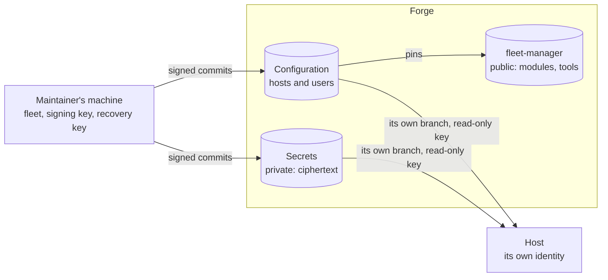

# 1. How it works

<!-- book:top — written by `fleet docs` from SUMMARY.md and the headings; do not edit -->
[← Preface](README.md) · [Contents](README.md) · [2. Installing a machine →](installing.md)
<!-- /book:top -->

A fleet is a set of machines that each build their own configuration from
git, on a timer, and take only commits a trusted key signed. Nothing is pushed
to a machine: each one pulls, checks, builds and activates by itself, and says
so when it cannot.

This chapter is the map. Each section names the chapter that has the detail,
and the [Glossary](glossary.md) defines the terms it uses.

<!-- book:sections -->
In this chapter:

- [The pieces](#the-pieces)
- [From `conf.*` to a system](#from-conf-to-a-system)
- [What a NixOS host does at each sync](#what-a-nixos-host-does-at-each-sync)
- [Things to know about the sync](#things-to-know-about-the-sync)
- [What it is built on](#what-it-is-built-on)
<!-- /book:sections -->

## The pieces

- **fleet-manager**, this repository, is the library: the `conf.*` vocabulary
  and the modules behind it, `lib.mkFleet`, the tools (`os-install`,
  `system-switch`, `home-switch`, `fleet`, `fleet-secrets`) and the tests. Its
  `hosts/` holds examples and test hosts.
- **The configuration** is the flake the machines build: a folder per host and
  per user. It can be this repository, or a private **inventory** that pins a
  commit of fleet-manager and builds its hosts with `lib.mkFleet`
  ([A private fleet](private-fleet.md)). With host branches, each host fetches
  a branch that holds only its own folder.
- **The secrets repository** is private and holds sops ciphertext only, one
  branch per host, each file encrypted to one host and the maintainer's
  recovery key ([Secrets](secrets.md)).
- **The maintainer's machine** holds the signing key and the recovery key, and
  runs `fleet`, which walks through each procedure and checks every commit it
  builds on against the maintainer's own copy of the trusted keys and commits
  ([Signing commits and trusting them](signing-and-trust.md),
  [The fleet tool](fleet-tool.md)).
- **A host** makes its own identity at install: an age key that decrypts its
  secrets and two read-only deploy keys, one for the secrets and one for a
  private configuration. The private halves never leave it.

## From `conf.*` to a system

`lib.mkFleet` (or this repository's `flake.nix`) finds one folder per host and
builds it with NixOS or nix-darwin, after `nixpkgs.hostPlatform`. Every `.nix`
file in the folder is a module. The host sets `conf.*` options, the shared
vocabulary declared in `modules/conf/options/`, and writes anything the
vocabulary does not cover as plain NixOS or nix-darwin options beside them.

`conf.role` (what the machine is for) and `conf.machineType` (what it
physically is) set defaults with `lib.mkDefault`, so a plain value in the host
always wins ([Roles and machine types](roles.md)). Each concern is implemented
once, under `modules/linux/`, `modules/darwin/` or `modules/common/`, behind
its own `mkIf`, so turning an option on in a host is all it takes. Each account
in `conf.users.accounts` gets a Home Manager home assembled from the baseline in
`modules/user/` and the user's own folder ([Accounts and homes](accounts.md)).
Every option is in the [Configuration reference](configuration.md).

## What a NixOS host does at each sync

A host with `conf.fleet.repo.url` runs the sync, `config-auto-update`, on a
timer: daily at 04:00 by default, with up to 30 minutes of random delay
(`conf.fleet.autoUpdate`), and at the next start for a machine that was off.
`fleet-sync-now` at the machine, or `fleet host sync` from the maintainer's
machine, starts it at once. Each run goes through these steps, and stops at
the first that fails:

1. **Secrets first**, on a host with secrets. It fetches the host's branch of
   the secrets repository, and the branches of the users its file lists,
   checks each signature and that no branch went back, and keeps a snapshot of
   only this host's files. A host whose secrets cannot be refreshed or verified
   does not go on to build against old ones.
2. **The checkout.** The configuration checkout, `/etc/nixos` by default, must
   be there, owned by root and not writable by others. A missing one is made
   again by the first-boot clone.
3. **Fetch.** It fetches the one branch it tracks, from the address its
   configuration names, retrying while the network comes up. A private
   configuration is fetched with the host's own read-only key.
4. **Signature.** The newest commit must be signed by a key in the signers
   file of the configuration the host already runs, so a pushed commit cannot
   add a key and approve itself.
5. **No going back.** The commit must be the one the host accepted last, or
   follow it, so an old signed commit served again is refused.
6. **Check out.** The checkout moves to the commit, detached, holding nothing
   else, and the commit is recorded as accepted.
7. **Secrets check.** A configuration that needs a secret the snapshot lacks is
   refused before it is built.
8. **Build.** A configuration that does not build leaves the running system
   untouched.
9. **Activate.** A new system is switched to. If its activation fails, the host
   returns to the previous generation. A system that is the same, with new
   secrets, is activated again so they reach `/run/secrets`.
10. **Repair.** Every run checks that the maintainer can still log in as
    `support` (the account, its keys, its sudo rule and sshd), and activates the
    running system again to mend them when nothing else changed.
11. **Reboot**, only with `allowReboot`, when the kernel or initrd changed.

When a run stops on something a person has to fix, everyone at the machine is
told, until a run succeeds. A fetch that fails is retried at the next run and
shows nothing.

A new host gets there through its install: `os-install` partitions, installs
and makes the host's identity, and at the first boot `fleet-bootstrap` clones
the configuration at the commit the system was built from. The sync goes on
from that checkout ([Installing a machine](installing.md)).

macOS hosts build from the same vocabulary, where nix-darwin can, but have no
sync yet: they are switched by `bootstrap`, by hand, or by MDM running it.

## Things to know about the sync

**Fleet machines pull; they cannot push.** The checkout's push URL is set to an
unusable value by the first-boot clone and re-applied on every sync, so a `git push` from a
fleet machine fails. That is hygiene; the control is the credential: a public
repository, at an `https://` address, needs none, and a private one, at an SSH
address, is read with the host's own configuration key, which has read access
only. The fetch URL is set from `conf.fleet.repo.url` on every sync too, so a
host follows its configuration to another repository.

**The sync refuses unsigned configuration, plain `http://` remotes, and a
checkout it does not own.** `conf.fleet.signing.allowedSignersFile` is required
alongside `repo.url`; `http://` fails evaluation; and the sync exits before
building if `localPath` is not root-owned or is group- or world-writable. An
SSH remote is checked against GitHub's published host keys, which the library
carries (`lib/forge-host-keys.nix`), for the configuration, the secrets and
the install alike; a key that does not match stops the fetch. Another forge's
key is taken the first time a host connects, and held to after that.

**Only the newest commit is checked, and GitHub's merge buttons break it.**
The sync verifies the tip of the tracked branch. GitHub's rebase, squash and
merge buttons drop your signature or replace it with GitHub's own, so after
such a merge every host stops updating, and everyone at those hosts sees the
notice below. Merge locally and push instead.

**A host never goes back to an older commit.** Each host remembers the last
commit it accepted: for its configuration in `/var/lib/fleet-sync/accepted`,
for its secrets in `<statePath>/accepted/host`. It takes a new tip only if it is that
commit or built on it. An older signed commit served again, by someone who can
push but holds only old signatures, is refused, and the notice says so. Fix a
mistake with a new commit on top, a revert included, and never rewind `main` or
the secrets repository with a force push. When a history is rewritten on
purpose, remove the record on each host (`sudo rm /var/lib/fleet-sync/accepted`,
or `sudo rm /var/lib/fleet/accepted/host` for the secrets, and
`accepted/user-<name>` for a user's own branch); the next sync then takes what it
fetches. A new install records the revision it was installed from; a host
without a record takes the first commit it fetches. The record holds when a
host's configuration moves to another repository too. A new address for the
same history passes as it is. A move to another history, as to
[a private fleet](private-fleet.md), stops the sync until the record is
removed on the host, right after the switch that moved it. `fleet host enroll`
does that when it moves a host: the first-boot clone then records the commit
the host was switched to. The record never starts over by itself: right after
a move, anyone who can push to the new repository could serve an old commit
of it. `accepted.url`, beside the record, says where the record's commit came
from.

**Everyone at a fleet host sees it when updates stop.** When a sync run stops
on something a person has to fix, such as an unsigned commit, a configuration
that does not build, a missing secret or a failed activation, it records why in
`/var/lib/fleet-sync/status`. Every account then sees it: a persistent
notification in a graphical session, shown again on every run that stops and
taken down by the first one that succeeds, and a few lines at every shell
login, which covers SSH and headless hosts. `fleet-sync-status` prints it on
demand. A fetch that fails, usually the network, is retried on the next run and
shows nothing. On a host with secrets, a second, smaller notice names the users
whose own branch failed a check; the machine still updates, and they keep the file
they had. It reads `/var/lib/fleet-sync/user-problems`, a copy of the sync's list,
and `/var/lib/fleet-sync/secrets-applied` records the snapshot the running system
was last activated with.

**A privileged account can sync a host at once.** `fleet-sync-now` starts the
sync without waiting for its timer. It needs no `sudo` and no password, which
suits a host where a privileged account has none. It shows the sync's log as it
runs, then the commit the machine runs against the newest one of its branch,
then what `fleet-sync-status` says. Other accounts cannot start it.

**Automatic updates discard local edits.** With `resetLocalChanges` on, which is
the default, the checkout is hard reset to the tracked ref before building, so
anything edited in place on the machine is lost, local branches included. With
it off, a machine that has diverged stops converging instead, and its local
branches are left alone.

**A rolled-back machine does not match its revision.** If activation fails and
`rollbackOnFailure` is on, the machine returns to its previous generation while
the checkout stays at the new one. The two disagree until upstream is fixed,
which is why the condition needs reporting rather than silence.

## What it is built on

The flake inputs, which `flake.lock` pins:

| Input | Ref | Purpose |
|---|---|---|
| `nixpkgs` | nixos-26.05 | base packages and modules |
| `nixpkgs-unstable` | nixos-unstable | declared, not used by any module |
| `nix-darwin` | nix-darwin-26.05 | macOS support |
| `home-manager` | release-26.05 | per-user environments |
| `dms` | stable | DankMaterialShell |
| `noctalia` | main | Noctalia shell |
| `caelestia-shell` | main | Caelestia shell |
| `disko` | master | declarative disk partitioning |
| `apple-fonts` | master | SF Pro and SF Mono |
| `sops-nix` | master | secrets, decrypted with sops at activation |
| `nixos-raspberrypi` | develop | Raspberry Pi board support, for Pi hosts and `rpi-image` |
| `microvm` | main | microVM guests on `pi-gw` |

<!-- book:bottom -->
---

[← Preface](README.md) · [Contents](README.md) · [2. Installing a machine →](installing.md)
<!-- /book:bottom -->
