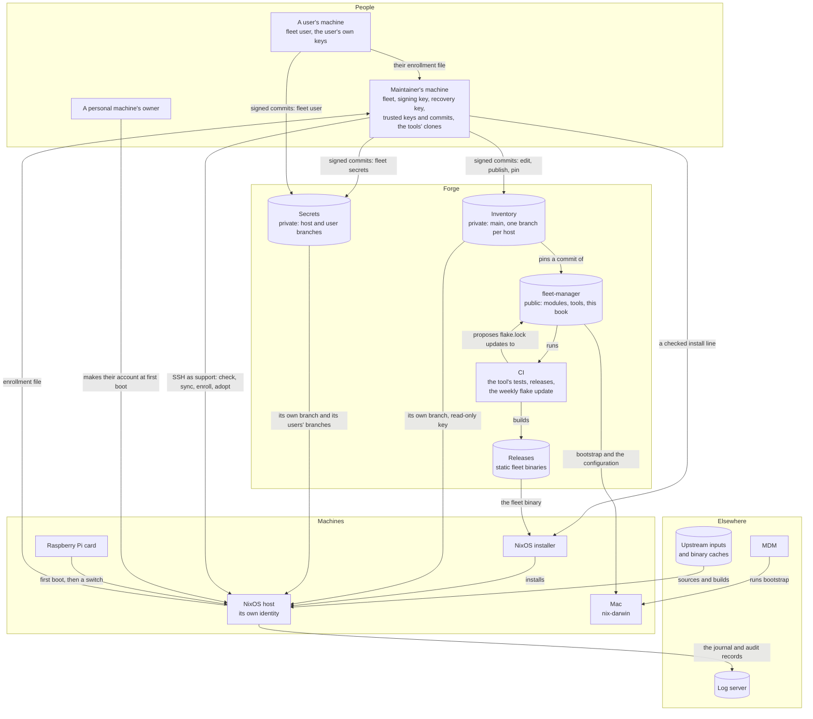
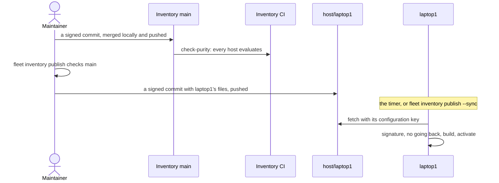
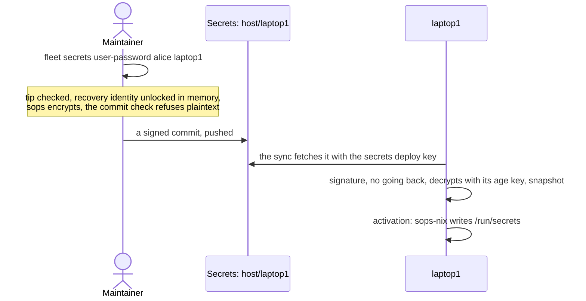

# 1. How it works

<!-- book:top — written by `fleet docs` from SUMMARY.md and the headings; do not edit -->
[← Preface](README.md) · [Contents](README.md) · [2. Installing a machine →](installing.md)
<!-- /book:top -->

A fleet host builds its own configuration from git, on a timer, and takes only
commits a trusted key signed. Nothing is pushed to it: it pulls, checks, builds
and activates by itself, and says so when it cannot. The maintainer changes
what the hosts build by pushing signed commits, and the tools on the
maintainer's machine check the same signatures before they build on anything.
A few flows reach a host another way, such as an install, bringing in a
running machine, or a switch by hand. This chapter names each one.

This chapter is the map. It shows every party and every flow between them,
explains each flow in a section of its own, and names the chapter that has the
detail. The [Glossary](glossary.md) defines the terms it uses.

<!-- book:sections -->
In this chapter:

- [The pieces](#the-pieces)
- [From `conf.*` to a system](#from-conf-to-a-system)
- [Every flow at a glance](#every-flow-at-a-glance)
- [A change reaches a host](#a-change-reaches-a-host)
- [What a NixOS host does at each sync](#what-a-nixos-host-does-at-each-sync)
- [Secrets reach a host](#secrets-reach-a-host)
- [Users who keep their own secrets](#users-who-keep-their-own-secrets)
- [A new machine](#a-new-machine)
- [Bringing in a running machine](#bringing-in-a-running-machine)
- [Personal machines and adoption](#personal-machines-and-adoption)
- [The maintainer's machine](#the-maintainers-machine)
- [Reaching a host](#reaching-a-host)
- [A newer fleet-manager, CI and releases](#a-newer-fleet-manager-ci-and-releases)
- [Homes](#homes)
- [Logs and audit](#logs-and-audit)
- [Code that reaches machines in other ways](#code-that-reaches-machines-in-other-ways)
- [macOS and the Raspberry Pi](#macos-and-the-raspberry-pi)
- [Things to know about the sync](#things-to-know-about-the-sync)
- [What it is built on](#what-it-is-built-on)
<!-- /book:sections -->

## The pieces

- **fleet-manager**, this repository, is the library: the `conf.*` vocabulary
  and the modules behind it, `lib.mkFleet`, the tools (`os-install`,
  `system-switch`, `home-switch`, `fleet`, `fleet-secrets`), the tests and this
  book. Its `hosts/` holds examples and test hosts.
- **The configuration** is the flake the machines build: a folder per host and
  per user. It can be fleet-manager itself, or a private **inventory** that
  pins a commit of fleet-manager and builds its hosts with `lib.mkFleet`
  ([A private fleet](private-fleet.md)). With host branches, each host fetches
  a branch of its own, `host/<name>`, which holds the flake, its lock, `fleet/`,
  the host's folder, its users' folders and any shared paths, and nothing of
  the other hosts.
- **The secrets repository** is private and holds sops ciphertext: a branch per
  host, `host/<name>`, with that host's files, and a branch per user who keeps
  their own, `user/<name>`. Each file is encrypted to one host and the
  maintainer's recovery key, and a user's files to the user as well. Each
  branch also holds a plain enrollment record, and `main` holds the
  repository's commit check ([Secrets](secrets.md)).
- **The maintainer's machine** holds the signing key and the recovery
  identity, and runs `fleet`. `fleet` keeps the maintainer's own copy of each
  repository's keys, the commits trusted last on each branch, and clones of
  the repositories for the tools alone. It checks every commit it builds on
  against them ([The maintainer's machine](#the-maintainers-machine)).
- **A user's machine**, for a user who keeps their own secrets, holds that
  user's own age identity and signing key, and runs `fleet user`.
- **A host** has an identity of three keys: an age key that decrypts its
  secrets, and two read-only deploy keys, one for the secrets and one for a
  private configuration. It makes them itself, at install, at its first boot,
  or when `fleet host enroll` brings it in. They leave it only through
  `fleet-identity --export`, for a planned reinstall.
- **CI** on the forge tests the `fleet` tool, publishes its static binaries as
  releases, and proposes a weekly update of the flake's inputs.
- **Upstream inputs and binary caches** are where the code a host runs comes
  from: the flake inputs fleet-manager pins, and the caches that save
  building them.
- **The log server**, when a host names one, receives its journal and audit
  records.
- **Macs and Raspberry Pi cards** take part in fewer flows; see
  [macOS and the Raspberry Pi](#macos-and-the-raspberry-pi).

## From `conf.*` to a system

`lib.mkFleet` (or this repository's `flake.nix`) finds one folder per host and
builds it with NixOS or nix-darwin, after `nixpkgs.hostPlatform`. Every `.nix`
file in the folder is a module. The host sets `conf.*` options, the shared
vocabulary declared in `modules/conf/options/`, and writes anything the
vocabulary does not cover as plain NixOS or nix-darwin options beside them.

`conf.role` (what the machine is for) and `conf.machineType` (what it
physically is) set defaults with `lib.mkDefault`, so a plain value in the host
always wins ([Roles and machine types](roles.md)). Each concern is implemented
once, under `modules/linux/`, `modules/darwin/` or `modules/common/`, behind
its own `mkIf`, so turning an option on in a host is all it takes. Each account
in `conf.users.accounts` gets a Home Manager home assembled from the baseline in
`modules/user/` and the user's own folder ([Accounts and homes](accounts.md)).
Every option is in the [Configuration reference](configuration.md).

## Every flow at a glance

| Flow | Started by | What moves | Checked by | Explained in |
|---|---|---|---|---|
| A change reaches a host | the maintainer: push, then `fleet inventory publish` | the configuration, to each host's branch | the tools: main signed and trusted; the host: signature, no going back | [A change reaches a host](#a-change-reaches-a-host) |
| The periodic sync | the host's timer; `fleet-sync-now`; several `fleet` commands | the configuration and the secrets, to the host | signature, no going back, the build, the activation | [What a NixOS host does at each sync](#what-a-nixos-host-does-at-each-sync) |
| Secrets from the maintainer | `fleet secrets …`, `fleet host secret` | ciphertext, to a host's branch | the branch's tip signed and trusted; the commit check | [Secrets reach a host](#secrets-reach-a-host) |
| Secrets from a user | `fleet user password`, `keys`, `secret` | ciphertext, to the user's branch | the user's own key; the host checks the recipients | [Users who keep their own secrets](#users-who-keep-their-own-secrets) |
| A user joins, or leaves | `fleet user init`, `fleet secrets user-enroll`, `user-retire` | the user's enrollment file, to the maintainer; the user's files, to their branch | a channel the maintainer trusts | [Users who keep their own secrets](#users-who-keep-their-own-secrets) |
| A new machine | `bootstrap`, or the line `fleet install prep` prints | the install line, the `fleet` binary, the configuration | the commits' signatures; bootstrap's SHA-256 | [A new machine](#a-new-machine) |
| Enrollment at install | the installer, then `fleet secrets host-enroll` | the enrollment file, to the maintainer; deploy keys, to the forge | a channel the maintainer trusts | [A new machine](#a-new-machine) |
| The first boot | `fleet-bootstrap`, on the host | the secrets, then the configuration's checkout | as in the sync | [A new machine](#a-new-machine) |
| A running machine comes in | `fleet host enroll` | the host's identity; a switch, over SSH | the commit, on the maintainer's machine | [Bringing in a running machine](#bringing-in-a-running-machine) |
| A host moves into the inventory | `fleet inventory import` | the host's folder, from fleet-manager to the inventory | the source commit; the host evaluates | [Bringing in a running machine](#bringing-in-a-running-machine) |
| A personal machine's owner | the owner, at the first boot | their account, on the machine only | none | [Personal machines and adoption](#personal-machines-and-adoption) |
| Adoption | `fleet host adopt` | the owner's password hash and keys, to the secrets | as for secrets | [Personal machines and adoption](#personal-machines-and-adoption) |
| The maintainer's trust | `fleet setup`, `trust signers`, `repo add`, `repo sync` | keys and trusted commits, into the maintainer's own state | the maintainer, who reviews each change | [The maintainer's machine](#the-maintainers-machine) |
| Reaching a host | `fleet host check`, `host sync`, `host secret`, `support-key rotate` | commands over SSH, as `support` | the host's key, already known | [Reaching a host](#reaching-a-host) |
| A newer fleet-manager | `fleet inventory pin` | the pin in the inventory's `flake.lock` | every commit since the last pin signed and trusted | [A newer fleet-manager, CI and releases](#a-newer-fleet-manager-ci-and-releases) |
| The weekly flake update | CI, every Monday | a pull request that updates fleet-manager's `flake.lock` | `check-purity`; the commit is not signed | [A newer fleet-manager, CI and releases](#a-newer-fleet-manager-ci-and-releases) |
| The tool's releases | CI, on a push to main that changes the tool | static `fleet` binaries | `SHA256SUMS` and attestations | [A newer fleet-manager, CI and releases](#a-newer-fleet-manager-ci-and-releases) |
| The tests | `nix flake check`, by hand; CI for the tool only | nothing leaves the machine | the checks themselves | [A newer fleet-manager, CI and releases](#a-newer-fleet-manager-ci-and-releases) |
| Homes | a system switch; `home-switch` for a self-managed home | a home generation | none; a notice when a home falls behind | [Homes](#homes) |
| Logs and audit | journald, auditd and Grafana Alloy, on the host | the journal and audit records, to the log server | none in the module | [Logs and audit](#logs-and-audit) |
| Notices | the sync, when it stops | why, to everyone at the machine | none | [Things to know about the sync](#things-to-know-about-the-sync) |
| Other code | binary caches, fwupd, Flatpak, Homebrew, the Lix installer | packages, firmware and apps | Nix's cache signatures; each vendor's own | [Code that reaches machines in other ways](#code-that-reaches-machines-in-other-ways) |
| A Mac | `bootstrap`, MDM, `darwin-rebuild` | the configuration, at a switch | none | [macOS and the Raspberry Pi](#macos-and-the-raspberry-pi) |
| A Raspberry Pi | `rpi-image`, then the card's first boot | the image, and each card's settings | none | [macOS and the Raspberry Pi](#macos-and-the-raspberry-pi) |

## A change reaches a host

1. The maintainer edits the inventory's `main`, signs the commit, merges it
   locally and pushes. GitHub's merge buttons would drop the signature.
2. The inventory's own CI runs `nix run .#check-purity`, so every host still
   evaluates.
3. `fleet inventory publish` checks that main's newest commit is signed by a
   key the maintainer trusts, follows the commit trusted last and is pushed,
   and that its fleet-manager pin is a trusted one. For each host it cuts the
   host's files from that commit, checks that the host evaluates from them
   alone, and adds a signed commit to every branch whose files changed. It
   pushes them all at once, once the maintainer approves.
4. Each host takes its branch at its next sync, or at once with `--sync`.

A configuration without host branches skips step 3: its hosts track `main`
itself, and a signed commit there is all it takes. How the inventory is set up
and used is in [A private fleet](private-fleet.md).

## What a NixOS host does at each sync

A host with `conf.fleet.repo.url` runs the sync, `config-auto-update`, on a
timer: daily at 04:00 by default, with up to 30 minutes of random delay
(`conf.fleet.autoUpdate`), and at the next start for a machine that was off.
`fleet-sync-now` at the machine starts it at once, and so do these commands on
the maintainer's machine: `fleet host sync`, `fleet inventory publish --sync`,
`fleet host enroll`, `fleet host secret --sync` and `fleet support-key rotate`.
Each run goes through these steps, and stops at the first that fails:

1. **Secrets first**, on a host with secrets. It fetches the host's branch of
   the secrets repository, and the branches of the users its file lists,
   checks each signature and that no branch went back, and keeps a snapshot of
   only this host's files. A host whose secrets cannot be refreshed or verified
   does not go on to build against old ones.
2. **The checkout.** The configuration checkout, `/etc/nixos` by default, must
   be there, owned by root and not writable by others. A missing one is made
   again by the first-boot clone.
3. **Fetch.** It fetches the one branch it tracks, from the address its
   configuration names, retrying while the network comes up. A private
   configuration, at an SSH address, is fetched with the host's own read-only
   configuration key; a public one, at an `https://` address, with no key.
4. **Signature.** The newest commit must be signed by a key in the signers
   file of the configuration the host already runs, so a pushed commit cannot
   add a key and approve itself.
5. **No going back.** The commit must be the one the host accepted last, or
   follow it, so an old signed commit served again is refused.
6. **Check out.** The checkout moves to the commit, detached, holding nothing
   else, and the commit is recorded as accepted.
7. **Secrets check.** A configuration that needs a secret the snapshot lacks is
   refused before it is built.
8. **Build.** The flake's inputs are fetched by the hashes its lock names, and
   what is already built comes from the binary caches. A configuration that
   does not build leaves the running system untouched.
9. **Activate.** A new system is switched to. If its activation fails, the host
   returns to the previous generation. A system that is the same, with new
   secrets, is activated again so they reach `/run/secrets`.
10. **Repair**, where the support account is on. On a run that changes
    nothing, the sync checks that the maintainer can still log in as
    `support` (the account, its keys, its sudo rule and sshd), and activates
    the running system again to mend them. After a switch it only checks, and
    records what is broken.
11. **Reboot**, only with `allowReboot`, when the kernel or initrd changed.

When a run stops on something a person has to fix, everyone at the machine is
told, until a run succeeds. A fetch that fails is retried at the next run and
shows nothing; see [Things to know about the sync](#things-to-know-about-the-sync).

## Secrets reach a host

1. A `fleet secrets` command, or `fleet host secret`, works in a temporary
   worktree of the host's branch. It first checks that the branch's newest
   commit is signed by a key the maintainer trusts and follows the commit
   trusted last. It unlocks the recovery identity into memory only, encrypts
   with sops to the host and the recovery recipient, and commits, signed. The
   copy of the repository's commit check that `fleet setup` installed refuses
   anything under `hosts/` or `users/` that is not ciphertext. Some commands
   push for you; the others say how.
2. The host's sync fetches the branch with its secrets deploy key, checks the
   signature against the signers of the configuration it runs and that the
   branch did not go back, checks that the host's file decrypts with its age
   key, and keeps a snapshot of only its own files.
3. At activation, sops-nix decrypts the snapshot into `/run/secrets`, which is
   kept in memory. A password hash sets the account's password, again at
   every activation; `authorized_keys` is read by sshd at each login;
   `sudo_keys` by sudo; `ssh_key` becomes the user's SSH and git signing key.

A new host's branch is made by `fleet secrets host-enroll`, from the host's
enrollment file. `host-rekey` moves a reinstalled host to its new identity,
and `host-retire` deletes the branch. What goes where, who can decrypt what,
and every command are in [Secrets](secrets.md) and
[Secrets runbooks](secrets-runbooks.md).

## Users who keep their own secrets

1. **The user makes their identity.** `fleet user init`, on the user's machine,
   makes an age identity (encrypted with a passphrase), an SSH signing key and
   an enrollment file of their public halves. The user gives the file to the
   maintainer through a channel the maintainer trusts.
2. **The maintainer enrolls them.** `fleet secrets user-enroll` moves the user's
   files from the host branches to a branch of their own, `user/<name>`,
   encrypted to the user as well. It lists the user, with their age recipient
   and signing key, in each host's own file, which only the maintainer
   changes, and pushes the user's branch, then the host branches.
3. **The user changes their files.** `fleet user password`, `fleet user keys`
   and `fleet user secret` fetch the user's branch, check that its newest
   commit is signed by the user or by a key they trust, edit it with sops, and
   push a commit signed with the user's own key.
4. **The host takes them.** For each user its file lists, the sync fetches the
   user's branch and checks that the newest commit is signed by that user or
   the maintainer, does not go back, and holds a file for this host encrypted
   to exactly the user, the host and the recovery recipient. A user whose
   branch fails a check keeps the file the host had, and is named in the
   notices.
5. **The user leaves.** `fleet secrets user-retire` takes the user off every
   host's list and deletes their branch.

The maintainer's own commands still work for a listed user: they work on the
user's branch. The details are in
[Users with a branch of their own](secrets.md#users-with-a-branch-of-their-own)
in *Secrets*.

## A new machine

`bootstrap`, fetched with one `curl` line, decides what happens by where it
runs:

| Running on | It does |
|---|---|
| the NixOS installer | gets `fleet` and runs `fleet install`, a guided `os-install` |
| macOS | installs Lix, then switches the Mac with nix-darwin |
| an installed NixOS | runs `system-switch` for the host |
| another Linux | installs Lix and stops |

**The checked install line.** The plain `curl` line takes whatever `main` has
at that moment. `fleet install prep`, on the maintainer's machine, checks that
the configuration's commit and the fleet-manager commit the installer comes
from are signed by keys the maintainer trusts, are pushed and follow the
commits trusted last. It then prints a line that fetches `bootstrap` from that
fleet-manager commit, checks it against a SHA-256 worked out on the
maintainer's machine, and runs it with both commits pinned. The maintainer
pastes the line over SSH, after comparing the installer's host key with the
one on its screen. A private host can be installed only this way.

**The `fleet` binary on the installer.** With the pinned line, `bootstrap`
builds `fleet` from the pinned fleet-manager commit. Without it, `bootstrap`
downloads the latest release and checks it against that release's
`SHA256SUMS`. That shows the download is whole, not who built it; the
release's attestation is not checked. If neither works, it runs `os-install`
by itself.

**The install.** `fleet install` checks the machine, the network, the host and
the disks, and runs `os-install`. `os-install` partitions with disko,
installs, and makes the host's identity:

- For a **public configuration**, it installs first, makes the identity on the
  new disk, and then waits while the maintainer enrolls the host.
- For a **private configuration**, which the host cannot read yet, it makes the
  identity first, in memory. It waits for both deploy keys to be registered,
  clones the configuration at the pinned commit with the configuration key,
  installs from that clone, and writes the identity onto the new disk.

**Enrollment.** The install shows the host's enrollment file, its public keys,
on screen and as a QR code, and can copy it to a USB stick. On the maintainer's
machine, `fleet secrets host-enroll` makes the host's branch, support's keys
and each account's password are added, and the branch is pushed. The deploy
keys are registered read-only on the forge. When the maintainer presses Enter,
the installer fetches the host's secrets and checks that they decrypt, before
the first boot.

**The first boot.** `fleet-bootstrap` runs at the first boot, and again
whenever the checkout is missing. On a host with secrets, it completes the
identity if a key is missing, and syncs the secrets first, retrying every
minute until it can. Then it clones
the configuration into `/etc/nixos` at the commit the system was built from,
makes the clone unable to push, records the commit as accepted, and loads the
audit rules. From then on the timer's sync goes on from that checkout.

The whole install, with a diagram of what moves where, is in
[Installing a machine](installing.md).

## Bringing in a running machine

**A running NixOS machine.** `fleet host enroll` brings in a machine that is
already running, without a reinstall. It is the one flow that drives a host
from outside:

1. It logs in as an administrator account, through an SSH agent that holds only
   one key for an hour, so that sudo by SSH key works.
2. It chooses and checks, on the maintainer's machine, the commit to switch
   the host to.
3. It makes the host's identity on the host, from the checked fleet-manager
   commit if the host lacks the tool, copies the enrollment file back and
   compares its SHA-256.
4. It enrolls the host in the secrets, pushes, and registers both deploy keys
   read-only with `gh`, then checks that they are read-only.
5. It checks that the configuration fits the machine as it is, and that the
   host's branch holds every secret the configuration declares.
6. It warns that `/etc/nixos` will be replaced, and asks.
7. It switches the host, then replaces `/etc/nixos` with the fleet's checkout,
   made by the first-boot clone, and removes the old accepted records.
8. It syncs and checks the host, as `support`.

For a host that already runs a fleet configuration from another repository,
it moves the host to the new one instead.

**A host fleet-manager defines.** `fleet inventory import` copies a host's
folder and its users' folders from a commit of fleet-manager into the
inventory, adjusts the signers path and the address, checks that it evaluates
there, commits, pushes and publishes its branch. It refuses a host without
secrets. `fleet host enroll` then moves the running host over.

Both are in [A private fleet](private-fleet.md).

## Personal machines and adoption

**The owner's setup.** On a host with `conf.fleet.personal.enable`, the first
boot shows a short setup on the console instead of the login prompt. It offers
to join a Wi-Fi network, then asks for a username, a full name and a password,
and makes the account on the machine. The owner is an administrator by default
(`ownerPrivileged`). Accounts are mutable there, and the owner's account also
reads its own `~/.ssh/authorized_keys`. Nothing of the owner goes to the
inventory or the secrets.

**Adoption.** Later, `fleet host adopt` logs in as `support` and reads who the
owner is. It reads their password hash with sudo, never shows it and passes it
on standard input only, and reads their `~/.ssh/authorized_keys`. It stores
the hash and the keys in the secrets, pushes them, and prints the declaration
to add to the host's folder. The maintainer adds it, removes `personal.enable`,
publishes and syncs. From then on the host is an ordinary fleet host.

Both are in
[Personal machines](accounts.md#personal-machines) in *Accounts and homes*.

## The maintainer's machine

`fleet setup` prepares the maintainer's machine once:

1. It makes the recovery identity, encrypted with a passphrase, and caches its
   recipient.
2. It makes a signing key and has both checkouts sign every commit.
3. It installs a reviewed copy of the secrets repository's commit check.
4. It adds the maintainer's key to the configuration's `fleet/allowed_signers`,
   in a signed commit it does not push.
5. It keeps the maintainer's own copy of that file's keys.

What the tools keep, and where:

| What | Where |
|---|---|
| The recovery identity, encrypted with a passphrase | `~/.fleet/recovery.age` |
| Its recipient, so the tools can encrypt without the passphrase | `$XDG_STATE_HOME/fleet/recovery.pub` |
| Your copy of a repository's keys | `$XDG_STATE_HOME/fleet/repos/<forge>/<owner>/<repo>/allowed_signers` |
| The commit trusted last on each branch | `…/<repo>/trusted/<branch>`, next to the keys |
| The tools' own clones | `$XDG_DATA_HOME/fleet/repos/<forge>/<owner>/<repo>` |
| The clones' names | `$XDG_STATE_HOME/fleet/names` |
| A user's identity and signing key, on the user's machine | `~/.fleet/user.age`, `~/.ssh/fleet_user_signing_key` |

`$XDG_STATE_HOME` is `~/.local/state` and `$XDG_DATA_HOME` is `~/.local/share`
when they are unset.

**Before each command.** Every command given a repository's name first brings
the tools' own clone up to date. It fetches the clone, and takes main's newest
commit only if a key you trust signed it, every commit since the one trusted
last is signed too, and it follows that one. A command given a checkout
compares the keys it lists with your copy, and warns when they differ. The
secrets commands refuse to run while git checks signatures against a file
inside a checkout, or runs the repository's own commit check rather than your
copy.

**Taking in what is new.** `fleet trust signers` takes a change of a
repository's keys, but only through a commit signed by a key already in your
copy, and shows the change first. `fleet repo add` makes a tool's clone and
gives it a name. `fleet repo sync` lists the new commits on every branch,
with who signed each, and moves the trusted commits on once you agree. It
refuses a branch that went back or was rewritten, unless you accept that by
typing the branch's name.

All of it is in [Signing commits and trusting them](signing-and-trust.md).

## Reaching a host

**The support account.** Every fleet host with secrets has `support`, the
maintainer's way in. It logs in with keys only, from the secrets on a host
with secrets, and has sudo without a password, since it has no password to
give. Its console password, if any, also comes from the secrets. The sync
repairs it ([What a NixOS host does at each sync](#what-a-nixos-host-does-at-each-sync)).

**How the tools use SSH.** The tools log in as `support`, with no agent
forwarded and no prompts. So they reach only a host whose key the
maintainer's machine already knows: the first connection is made by hand,
comparing the fingerprint. `fleet host enroll`, on a machine that does not run
a fleet configuration yet, logs in as an administrator account instead, as
described above.

**The commands.**

- `fleet host check` reads, without changing anything, whether the host runs
  the revision its checkout holds, how its last sync ended and when, what its
  secrets snapshot holds, and whether any unit failed.
- `fleet host sync` compares what the host runs with what is published,
  starts its sync with `sudo`, and shows the sync's log if it fails.
- `fleet host secret --from-host` reads a secret's current value off the host,
  to keep it in the secrets.
- `fleet support-key rotate` makes a new key and adds it next to the old one.
  It syncs with the old key, tests the new one, removes the old one, syncs
  again, and checks that the old key is refused.
- At the machine, a privileged account runs `fleet-sync-now` to sync at once,
  without sudo or a password.

The commands are in [The fleet tool](fleet-tool.md), with a page each in the
[runbooks](../tools/fleet/runbooks/README.md).

## A newer fleet-manager, CI and releases

**Moving the inventory to a newer fleet-manager.** `fleet inventory pin`
brings fleet-manager's clone up to date and takes its newest main, or a commit
you name. It lists the commits the pin moves over, and pins only if each is
signed by a key you trust. It evaluates every host before and after, naming
the hosts whose system changes, then commits `flake.lock`, signed, and pushes
it. Hosts take the new fleet-manager when you publish.
`fleet inventory publish`, `fleet install prep` and `fleet host enroll` check
the pin the same way. See
[Moving to a newer fleet-manager](private-fleet.md#moving-to-a-newer-fleet-manager)
in *A private fleet*.

**The weekly flake update.** Every Monday at 03:00, CI runs `nix flake update`
in fleet-manager and checks that every system still evaluates purely. If the
lock changed, it commits it and opens or refreshes a pull request from the
`ci/update-flake` branch, or deletes that branch when nothing changed. The
commit is the CI's own and is not signed. So it cannot be merged as it is: a
host would refuse it as its newest commit, and the tools refuse a
fleet-manager pin past an unsigned commit. To take it, review the lock's
change, and make it a commit of your own, signed: check out the branch and
re-sign its commit (`git commit --amend -S --no-edit`), then merge that
locally and push.

**CI for the tool.** A pull request or a push to `main` that changes
`tools/fleet` runs `gofmt`, `go vet`, the Go tests and
`nix build .#checks.x86_64-linux.fleet`. A push to `main` then builds static
`fleet` binaries for Linux and macOS, on x86_64 and aarch64. It publishes them
as the latest release, `fleet-<commit>`, with `SHA256SUMS` and a signed
attestation of where each came from (`gh attestation verify`). The installer
takes these binaries when it has no pinned commit; see
[A new machine](#a-new-machine).

**The tests.** The other flake checks, the VM tests and the `docs` check of
this book among them, run with `nix flake check` and are not run by CI. Run
them before merging. `nix run .#secrets-harness` stands in for the secrets
repository in a local test; see
[`tests/secrets/README.md`](../tests/secrets/README.md).

## Homes

A home managed by the system is activated with each system switch. A user
with `selfManagedHome` activates their own with `home-switch`, from the flake
and their own `~/.config/home-manager`. Every system and every home generation
records the revision it was built from, in `/etc/org/revision` and
`~/.config/org/revision`. On a desktop, a self-managed home that falls behind
the system gets a notice at login, after each system switch and every 30
minutes. On NixOS, every account's git trusts the root-owned checkout in
`/etc/nixos`.
See [Accounts and homes](accounts.md).

## Logs and audit

Every Linux host keeps its journal, capped at 1 GiB and 90 days, and audits
commands run as root by a person and writes to the configuration checkout,
the system profiles, the account files, `sudoers` and `/etc/ssh`. With
`conf.fleet.logs.lokiUrl` set, Grafana Alloy sends the journal, audit records
included, to the fleet's Loki, labelled with the host, the unit, the level and
the transport. The module sets no authentication or TLS for it, so use an
address on a network you trust, or put TLS in front of Loki. See
[Hardening and auditing](things-to-know.md#hardening-and-auditing) in
*Things to know*.

## Code that reaches machines in other ways

Besides the flake and its inputs, code reaches the machines in these ways:

- **Binary caches.** Nix takes what is already built from `cache.nixos.org`,
  checked against the cache's signing key, and from the Noctalia cache on
  hosts with that shell. A Raspberry Pi image's kernel comes from the
  nixos-raspberrypi cache, for trusted users only.
- **Firmware**, from fwupd on laptops and desktops.
- **Flatpak apps**, where `conf.flatpak` is on, as their users install them.
- **On a Mac**, Homebrew packages and Mac App Store apps the host lists, and,
  on Apple silicon with `conf.virtualisation` on, Rosetta 2, installed by
  `softwareupdate`.
- **The Lix installer**, which `bootstrap` runs with `curl | sh` where Nix is
  missing, and `bootstrap` itself, from `main` unless the line is pinned.

## macOS and the Raspberry Pi

**A Mac** builds from the same vocabulary where nix-darwin can, but takes part
in fewer flows:

- `bootstrap`, run by hand or by MDM, installs Lix and switches the Mac with
  the nix-darwin the flake pins. Later switches are by hand, with
  `darwin-rebuild` or `system-switch`.
- There is no sync, no support account and no secrets sync on a Mac. Its
  accounts come from MDM.
- The Mac's sops wiring points at a secrets snapshot that nothing fills yet,
  and `fleet inventory publish` cuts a host branch for a Mac that no Mac
  fetches.

**A Raspberry Pi** starts from one image for every Pi 5:

1. `nix run .#rpi-image` builds it, for `aarch64-linux`.
2. Each card gets its own `firstboot/` files: a hostname, SSH keys for `root`
   and `nixos`, and a Wi-Fi network. They are applied once at the first boot,
   and the Wi-Fi file is then deleted from the card.
3. The maintainer logs in over SSH and switches the Pi to its host
   configuration. A Pi of a private fleet is brought in with
   `fleet host enroll`.

See [Building a Raspberry Pi image](raspberry-pi.md) and
[On a Mac](installing.md#on-a-mac) in *Installing a machine*.

## Things to know about the sync

**Fleet machines pull; they cannot push.** The checkout's push URL is set to an
unusable value by the first-boot clone and re-applied on every sync, so a `git push` from a
fleet machine fails. That is hygiene; the control is the credential: a public
repository, at an `https://` address, needs none, and a private one, at an SSH
address, is read with the host's own configuration key, which has read access
only. The fetch URL is set from `conf.fleet.repo.url` on every sync too, so a
host follows its configuration to another repository.

**Not every switch is checked.** `bootstrap` on an installed NixOS, and
`system-switch`, `nixos-rebuild` or `darwin-rebuild` run by hand, build
whatever flake they are given without checking a signature. On a fleet host
the next sync builds from its checked checkout again and switches back to it.
`fleet host enroll` switches a host from outside, from a commit it checked on
the maintainer's machine.

**The sync refuses unsigned configuration, plain `http://` remotes, and a
checkout it does not own.** `conf.fleet.signing.allowedSignersFile` is required
alongside `repo.url`; `http://` fails evaluation; and the sync exits before
building if `localPath` is not root-owned or is group- or world-writable. An
SSH remote is checked against GitHub's published host keys, which the library
carries (`lib/forge-host-keys.nix`), for the configuration, the secrets and
the install alike; a key that does not match stops the fetch. Another forge's
key is taken the first time a host connects, and held to after that.

**A host checks only the newest commit, and GitHub's merge buttons break it.**
The sync verifies the tip of the tracked branch; the maintainer's tools check
every commit since the one they trusted last. GitHub's rebase, squash and
merge buttons drop your signature or replace it with GitHub's own, so after
such a merge every host stops updating, and everyone at those hosts sees the
notice below. Merge locally and push instead. A commit that nobody signed,
such as the weekly flake update's, has to become a signed commit of your own
first ([A newer fleet-manager, CI and releases](#a-newer-fleet-manager-ci-and-releases)).

**A host never goes back to an older commit.** Each host remembers the last
commit it accepted: for its configuration in `/var/lib/fleet-sync/accepted`,
for its secrets in `<statePath>/accepted/host`. It takes a new tip only if it is that
commit or built on it. An older signed commit served again, by someone who can
push but holds only old signatures, is refused, and the notice says so. Fix a
mistake with a new commit on top, a revert included, and never rewind `main` or
the secrets repository with a force push. When a history is rewritten on
purpose, remove the record on each host (`sudo rm /var/lib/fleet-sync/accepted`,
or `sudo rm /var/lib/fleet/accepted/host` for the secrets, and
`accepted/user-<name>` for a user's own branch); the next sync then takes what it
fetches. A new install records the revision it was installed from; a host
without a record takes the first commit it fetches. The record holds when a
host's configuration moves to another repository too. A new address for the
same history passes as it is. A move to another history, as to
[a private fleet](private-fleet.md), stops the sync until the record is
removed on the host, right after the switch that moved it. `fleet host enroll`
does that when it moves a host: the first-boot clone then records the commit
the host was switched to. The record never starts over by itself: right after
a move, anyone who can push to the new repository could serve an old commit
of it. `accepted.url`, beside the record, says where the record's commit came
from.

**Everyone at a fleet host sees it when updates stop.** When a sync run stops
on something a person has to fix, such as an unsigned commit, a configuration
that does not build, a missing secret or a failed activation, it records why in
`/var/lib/fleet-sync/status`. Every account then sees it: a persistent
notification in a graphical session, shown again on every run that stops and
taken down by the first one that succeeds, and a few lines at every shell
login, which covers SSH and headless hosts. `fleet-sync-status` prints it on
demand. A run that switched and then finds support access broken records that
too, though the update itself went through. On a host with secrets, a second,
smaller notice names the users whose own branch failed a check; the machine
still updates, and they keep the file they had. It reads
`/var/lib/fleet-sync/user-problems`, a copy of the sync's list, and
`/var/lib/fleet-sync/secrets-applied` records the snapshot the running system
was last activated with.

**A fetch that fails shows no notice.** It is retried at the next run. That is
right for a network that is down, but a forge host key that does not match, or
a deploy key that was removed, fails the same way, and only a person can fix
them. `fleet host check` shows how the last sync ended, so run it when a host
seems not to update.

**A privileged account can sync a host at once.** `fleet-sync-now` starts the
sync without waiting for its timer. It needs no `sudo` and no password, which
suits a host where a privileged account has none. It shows the sync's log as it
runs, then the commit the machine runs against the newest one of its branch,
then what `fleet-sync-status` says. Other accounts cannot start it.

**Automatic updates discard local edits.** With `resetLocalChanges` on, which is
the default, the checkout is hard reset to the tracked ref before building, so
anything edited in place on the machine is lost, local branches included. With
it off, a machine that has diverged stops converging instead, and its local
branches are left alone.

**A rolled-back machine does not match its revision.** If activation fails and
`rollbackOnFailure` is on, the machine returns to its previous generation while
the checkout stays at the new one. The two disagree until upstream is fixed,
which is why the condition needs reporting rather than silence.

## What it is built on

The flake inputs, which `flake.lock` pins. Where the flake names no branch, the
input follows its upstream's default branch.

| Input | Branch | Purpose |
|---|---|---|
| `nixpkgs` | nixos-26.05 | base packages and modules |
| `nixpkgs-unstable` | nixos-unstable | declared, not used by any module |
| `nix-darwin` | nix-darwin-26.05 | macOS support |
| `home-manager` | release-26.05 | per-user environments |
| `dms` | stable | DankMaterialShell |
| `noctalia` | default | Noctalia shell |
| `caelestia-shell` | default | Caelestia shell |
| `disko` | default | declarative disk partitioning |
| `apple-fonts` | default | SF Pro and SF Mono |
| `sops-nix` | default | secrets, decrypted with sops at activation |
| `nixos-raspberrypi` | default | Raspberry Pi board support, for Pi hosts and `rpi-image` |
| `microvm` | default | microVM guests on `pi-gw` |

<!-- book:bottom -->
---

[← Preface](README.md) · [Contents](README.md) · [2. Installing a machine →](installing.md)
<!-- /book:bottom -->
