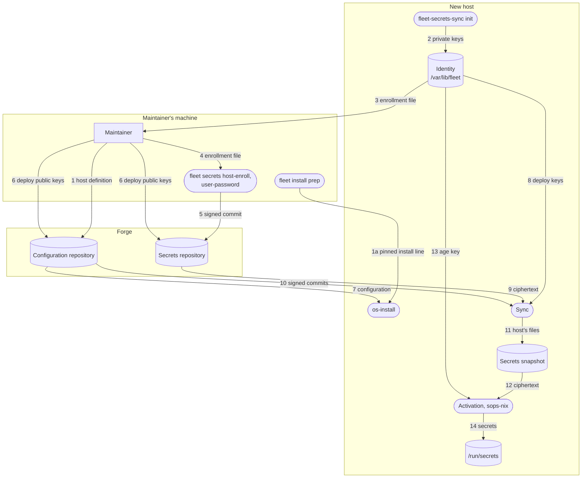

# 2. Installing a machine

<!-- book:top — written by `fleet docs` from SUMMARY.md and the headings; do not edit -->
[← 1. How it works](how-it-works.md) · [Contents](README.md) · [3. Building a Raspberry Pi image →](raspberry-pi.md)
<!-- /book:top -->

How a machine gets its first system. [First run](../README.md#first-run) in
the README gives the one command; this chapter has the rest: installing only
commits you have checked, a Mac, `os-install` and the disk layout it makes,
adding a disk later, and enrolling a host with secrets while it installs. It
assumes the overview in [How it works](how-it-works.md); what enrollment is
for is explained in [Secrets](secrets.md).

<!-- book:sections -->
In this chapter:

- [From checked commits](#from-checked-commits)
- [On a Mac](#on-a-mac)
- [Without bootstrap](#without-bootstrap)
- [With os-install](#with-os-install)
- [Adding a disk to a running machine](#adding-a-disk-to-a-running-machine)
- [What the install does](#what-the-install-does)
- [Enrolling during the install](#enrolling-during-the-install)
<!-- /book:sections -->

## From checked commits

The `bootstrap` command of the README's [First run](../README.md#first-run) takes whatever `main`
has at that moment, which anyone who can push could have changed. To install
only commits whose signatures you have checked, run this on your own machine,
in a checkout of the configuration:

```bash
fleet install prep <hostname>
```

It checks that the checkout's newest commit is signed by a key you trust and
pushed, and so is the fleet-manager commit the installer comes from. The keys
you trust are your own copy of each repository's `fleet/allowed_signers`, kept
by `fleet trust signers` (see
[Signing commits and trusting them](signing-and-trust.md)). Then it prints a line to run on the new machine instead.
That line fetches `bootstrap` by that commit, checks it against a SHA-256
worked out on your machine, and runs it with `REV` and `FLAKE` pinned to those
two commits. Everything after that is fetched with git, by hash. On the
installer ISO, set a password with `passwd` and paste the line over SSH rather
than typing it. When ssh asks about the installer's host key, compare the
fingerprint with the one the installer's own screen shows (`ssh-keygen -lf
/etc/ssh/ssh_host_ed25519_key.pub` there). Something else on the network could
pose as the installer, and would get the disk passphrase you type.

A private host is installed only this way: without the pins, `bootstrap`
stops, unless `UNPINNED=1` is in front of `sh`. A public host is installed
either way, with a warning when it is not pinned.

## On a Mac

On a Mac, the host is named explicitly the first time, since the machine still
has its default hostname and the switch is what sets it. The accounts listed in
`conf.users.accounts` must already exist, normally created by MDM, since
nix-darwin leaves macOS accounts alone by default. If activation stops with
"Unexpected files in /etc", the Nix installer wrote a file nix-darwin does not
recognise; rename it by adding `.before-nix-darwin` and run the command again.
After the first switch, `sudo darwin-rebuild switch --flake …` is on the PATH.

## Without bootstrap

Without `bootstrap`, from a checkout: on the NixOS ISO,
`nix --extra-experimental-features 'nix-command flakes' run .#os-install`; on a
Mac with Nix installed, `sudo nix run .#darwin-rebuild -- switch --flake .#<hostname>`.

## With os-install

```bash
nix run .#os-install                                   # pick the host and the disk from lists
nix run .#os-install -- -H my-laptop -d /dev/nvme0n1    # or give them as flags
nix run .#os-install -- --help
```

The host's disk layout is generated from `conf.hardware.disk`. `os-install`
only needs to know which host and which physical disk: anything not given as a
flag is chosen from a dropdown (`fzf`, fetched with the app, so nothing has to
be installed first). The disk list leaves out the installer's own boot medium.
It shows what will be erased and asks for the host name as confirmation
(`--yes` skips that), re-running itself with sudo if needed. `-d` takes
`NAME=DEVICE` when a layout declares more than one disk: `main` is
`disk.device`, any other name is a key of `disk.extraDevices`.
`--flake REF` installs from another flake, for example a pinned tag.

```nix
conf.hardware.disk = {
  enable = true;
  device = "/dev/nvme0n1";
  encrypt = true;                                    # the only encryption switch
  volumes.swap.size = "32G";                         # change one field of a default volume
  volumes.data = { size = "500G"; mountpoint = "/data"; };   # a custom volume
  extraDevices.scratch = "/dev/sdb";                 # a further disk joins the volume group
};
```

The layout is always one shape: an LVM volume group `main` over the primary
disk and every `extraDevices` disk, holding the volumes the host declares. With
`encrypt = true` each physical volume is wrapped in a LUKS2 container; with
`false` (a VM, say) it is bare. `encrypt` is the only encryption switch; there
is no second layout. A `fleet` volume (64 MB, mounted at `/var/lib/fleet`, in
the initrd) is always present: it holds the host's secrets identity and
survives a rebuild, or a manual reinstall that keeps it. `os-install` erases
the whole disk, so after an `os-install` the host identity only carries over
with `--identity`. `swap` (16G) and `root` (`100%FREE`, `/`) are
defaults a host changes field by field, or drops with `enable = false`. A host
that needs a layout these options cannot express leaves `disk.enable` off and
writes `hosts/<name>/disko-config.nix` itself, with
`modules/linux/baseline/disk.nix` as the reference.

## Adding a disk to a running machine

It takes two steps, in this order. First,
on the host, `sudo disk-extend <name> <device>` partitions the disk, creates the
LUKS container when the host is encrypted and asks you to choose its
passphrase (use the one the other disks have, so one prompt at boot still
unlocks them all), and joins it to the volume group; `--grow <volume>` also enlarges
that volume and its ext4 or xfs filesystem. It refuses a device that already
carries a filesystem, partition table or LUKS header, and prints the option to
add when it finishes. Second, in the flake, add `extraDevices.<name> =
"<device>"`, commit and switch, so the layout matches the machine and the
initrd unlocks the new container. Declaring the disk before running
`disk-extend` would make the initrd wait for a device that does not exist.

## What the install does

The live ISO keeps its writable store in RAM, so the install is arranged to
keep the system off it. The host's disko script partitions, formats and mounts
the disks at `/mnt`; `os-install` then turns on the swap the layout declares;
and `nixos-install` builds and downloads straight into `/mnt/nix/store`, with
its scratch space on the new disk and anything the ISO already holds copied
rather than downloaded. Only evaluating the configuration uses the installer's
RAM, and with swap on, that can page to the new disk. The system is installed
without a root password — root is locked by the configuration and
administration goes through sudo. A firmware boot entry is written when the
host sets `conf.hardware.boot.efiVariables`. A BIOS host must have the right
device in its layout, since GRUB installs to that one; `os-install` refuses a
different `-d` for it.

On first boot with network, a fleet host (one with `conf.fleet.repo.url`)
clones its configuration into `conf.fleet.localPath` at the revision it was
built from, and keeps retrying until it has a network. The sync starts from
that checkout.

**`/etc/nixos` belongs to the fleet.** Once a machine runs a fleet
configuration, however it got there, the checkout in `conf.fleet.localPath` is
the fleet's. The first-boot clone replaces whatever is there without a
checkout. Every sync leaves the checkout detached at the commit it verified,
holding only the branch it tracks, and, with `resetLocalChanges` on, no local
branches. When the checkout is missing, the sync starts the first-boot clone
again. Keep nothing of your own there.

disko asks for the passphrase while formatting; `os-install` asks once and
gives it to every LUKS container, and at boot one prompt unlocks them all. One
thing stays manual after the first boot, because it cannot happen before the
machine exists, and `os-install` prints it when it applies: enrolling the TPM
as a second unlock method when `conf.hardware.boot.tpm2Unlock` is set
(`systemd-cryptenroll --tpm2-device=auto --tpm2-pcrs=7 <luks device>`, asking
for the passphrase, once per container). Without a TPM chip the passphrase is
simply the only method; the TPM option falls through to it at boot.

## Enrolling during the install

A host with `conf.secrets.repo.url` also needs to be enrolled, which happens
during the install (the full flow is under [Onboarding a machine](secrets-runbooks.md#onboarding-a-machine) in *Secrets runbooks*).
After `nixos-install`, `os-install` creates the host's identity under
`/mnt/var/lib/fleet`, prints the enrollment file and a QR code of it, and
waits. On the maintainer's machine, `fleet-secrets host-enroll <host> --from
<file>` admits the host; back at the installer, pressing Enter fetches the
host's secrets and checks that they decrypt. These flags control the step:

| Flag | Effect |
|---|---|
| `--identity FILE` | Restore a host identity exported by `fleet-identity --export` instead of generating one; no enrollment is needed |
| `--no-enroll` | Do not wait for enrollment; the host boots with locked accounts and retries the secrets fetch until it is enrolled |
| `--enroll-out PATH` | Also copy the enrollment file to `PATH`, for example a mounted USB stick |
| `--flake git+ssh://…` | A private flake, which the host reads with its own configuration key: the identity is made first, the install waits until its keys are registered, then clones the flake and installs from it. With `?rev=<commit>`, as `fleet install prep` gives it, it installs exactly that commit, and stops if the repository does not have it. See [A private fleet](private-fleet.md) |

What moves where when a host is installed from the stock ISO and enrolled. The
numbers name the flows in the table below the diagram.



| # | What flows | Where and how |
|---|---|---|
| 1 | The host's definition, in a signed commit | Pushed before the install |
| 1a | The line that runs the install: the configuration commit and the fleet-manager commit the installer comes from, and `bootstrap`'s SHA-256 | `fleet install prep HOST` checks both commits' signatures; the line is pasted on the installer |
| 2 | Its age key, secrets deploy key and configuration deploy key | Made on the host; the private halves never leave it |
| 3 | The enrollment file: the age recipient and both deploy public keys | Shown as a QR code, or copied to a USB stick with `--enroll-out` |
| 4 | The enrollment file | `fleet secrets host-enroll HOST --from FILE` |
| 5 | Signed commits on the host's own branch, `host/HOST`, one per command: its enrollment record, support's keys, and the host's and its accounts' files, encrypted to the host and the recovery key | `host-enroll`, `user-keys support`, then `user-password` for each account, then `git push origin host/HOST` |
| 6 | Deploy public keys, registered read-only | The secrets deploy key on the secrets repository; the configuration deploy key on the configuration repository, for a private one only |
| 7 | The host's configuration, at the pinned commit | Cloned with the configuration deploy key when private; a repository without that commit stops the install |
| 8 | The secrets deploy key, and the configuration deploy key when private | Each fetch uses its own key and offers no other |
| 9 | The secrets, as ciphertext, in a signed commit | Verified, never older than the last one accepted, and only this host's files are kept |
| 10 | Configuration commits, signed | Verified and never older; the host rebuilds from them |
| 11 | This host's files | The snapshot in `/var/lib/fleet/secrets` |
| 12 | The ciphertext | Read at activation |
| 13 | The age key | Decrypts it |
| 14 | Passwords, keys and other secrets | In `/run/secrets`, with the owner and mode each secret declares |

The order depends on the configuration. A public one is installed first:
`init` makes the identity on the new disk after `nixos-install`, and the
installer waits while the host is enrolled, then fetches its secrets before
the first boot. A private one can't be read until the host is enrolled, so
`init` makes the identity first, in memory, the installer waits for both
deploy keys to be registered, then clones the configuration, installs, and
writes the identity onto the new disk.

<!-- book:bottom -->
---

[← 1. How it works](how-it-works.md) · [Contents](README.md) · [3. Building a Raspberry Pi image →](raspberry-pi.md)
<!-- /book:bottom -->
